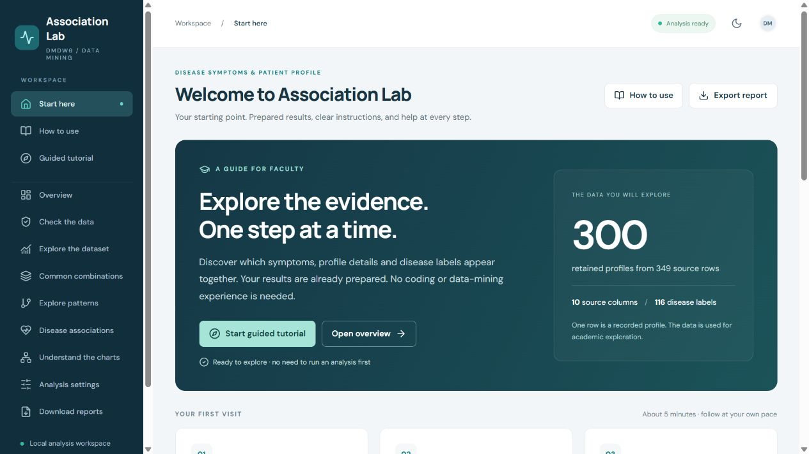

<div align="center">

# Association Lab
### From recorded profiles to understandable patterns

**A guided academic workspace for professors — no coding or data-mining experience needed to explore.**

Disease Symptoms & Patient Profile Dataset · DMDW6 · Apriori

[Start here](#start-here) · [Five-minute walkthrough](#your-five-minute-walkthrough) · [Reading results](#read-a-result-in-plain-language) · [Help](#troubleshooting) · [Technical guide](docs/TECHNICAL_GUIDE.md)

</div>

---

## What this project does

Association Lab asks **“Which recorded symptoms, profile details and disease labels appear together?”** It turns the supplied dataset into charts, searchable associations and downloadable reports. All displayed results come from the project's analysis; the guided examples update with the current results.

> **Academic exploration only.** These associations do not establish causes, diagnose patients or provide clinical recommendations. A high score can be based on only a few records.



## Start here

### Opening this prepared folder on this computer

1. Double-click **`START_PROJECT.cmd`**.
2. Wait for the browser to open. If it does not, visit **http://127.0.0.1:8000**.
3. Choose **Start guided tutorial**. The analysis is already prepared; you do not need to run it again.

Leave the launch window open while using the site. Close it, or press **Ctrl+C**, when finished. Do not double-click `frontend/index.html`; the site needs its local server.

### On a new Windows computer

1. Extract the complete project ZIP into a normal folder. Do not launch files from inside the ZIP viewer.
2. Install **Python 3.11 or newer**, with Python available on PATH. Python 3.11 is the tested environment.
3. Double-click **`SETUP_PROJECT.cmd`** once. Internet access is needed to install Python dependencies. Wait for “Setup completed”.
4. Double-click **`START_PROJECT.cmd`**.

**Node.js is only needed when rebuilding the website**, not for viewing the included built version. If `frontend/dist` is missing, install Node.js 22.12+ and run setup again. A virtual environment from another machine is not portable; recreate `.venv` using setup if necessary.

## Your five-minute walkthrough

| Step | Open | What to do |
| :--- | :--- | :--- |
| **1 · Meet the data** | Explore the dataset | Choose Disease or Age Group. Hover over a bar to see a record count. |
| **2 · Check the preparation** | Check the data | Compare source and retained rows; read the cleaning decisions. |
| **3 · Read an association** | Disease associations | Read every condition on the left together, then the disease on the right. Use the explanation underneath. |
| **4 · Understand the evidence** | Understand the charts | Each dot is a rule. Inspect its support, confidence, lift and record count. |
| **5 · Try a filter** | Explore patterns | Search for `Fever=Yes`. Select **Reset filters** to return to the full view. |
| **6 · Save your findings** | Download reports | Download the PDF for reading or a CSV for a spreadsheet. |

The **Guided tutorial** tab walks through these steps inside the site. **Try it** opens the relevant section; **Back to tutorial** returns to the same step. You can skip, revisit, exit or restart the tutorial. Progress is kept during the current page session; refreshing starts a new visit.

The **How to use** tab contains the section guide, chart-reading instructions, glossary and frequently asked questions.

## Read a result in plain language

A rule reads **“left-hand conditions → right-hand observation”**. All conditions on the left must occur together. The arrow means “associated in these records”; it does not mean “causes”.

The leading disease association at the shipped defaults is:

**Normal blood pressure + Difficulty breathing = Yes + Fatigue = No → Asthma**

| Measure | Actual default example | Plain meaning |
| :--- | :--- | :--- |
| **Count** | 6 records | Six records contain both sides. |
| **Support** | 6 / 300 = **2%** | How common the full combination is in all retained records. |
| **Confidence** | 6 / 11 = **54.5%** | Among the eleven records matching the left, six also have Asthma. |
| **Lift** | **10.23×** | Asthma is 10.23 times as common among those matching records as across the retained dataset. |

Asthma appears in 16 of 300 retained profiles. This is an in-sample association supported by six records, not diagnostic accuracy. After a new run, use the live worked example in **Start here** for the current result.

### Read the visualizations

- **Dataset bars:** longer means more records. Some charts show only the leading categories; the captions explain the limits.
- **Support vs confidence:** each dot is a rule. Further right = more frequent; higher = more consistent; larger bubble = greater lift.
- **Lift vs confidence:** the horizontal axis is lift instead of support.
- **Itemset chart:** a dot is a combination; height is its number of items; bubble size is its record count.
- **Disease symptom participation:** counts rules containing a recorded Yes, **not patients**.
- **Tables:** read exact patterns and values without needing to hover. Select **Show advanced metrics** only if you need leverage and conviction.

## Find your way around

| Section | Purpose |
| :--- | :--- |
| Start here | Welcome, recommended first steps and a real worked example |
| How to use | Instructions, glossary, chart explanations and troubleshooting |
| Guided tutorial | Six practical steps using current results |
| Overview | Current data and analysis summary |
| Check the data | Audit, duplicates, missing values and cleaning decisions |
| Explore the dataset | Category distributions and profile charts |
| Common combinations | Recurring groups of features, also called frequent itemsets |
| Explore patterns | Search, compare, sort and filter general association rules |
| Disease associations | Patterns with a disease label on the right |
| Understand the charts | Visual comparisons and companion ranking tables |
| Analysis settings | Optional controls for recomputing results |
| Download reports | PDF, CSV, Markdown and JSON downloads |

Use the menu button on smaller screens. The theme button switches between light and dark views. Keyboard users can tab to **Skip to content**, navigation, controls and help questions.

## Filters or a new analysis?

**Display filters change only what you see.** Search, choose a disease or open **Advanced filters**. Support and confidence inputs show percentages: enter **2** for 2%, not 0.02. Click a metric heading in a pattern table to sort. Click it again to reverse the order.

**Analysis settings change the search itself.** The prepared results are ready to use. To experiment, change settings, select **Run analysis**, and wait for the completion message. The results and report are regenerated together. **Restore defaults** fills the form; you must run again to apply them.

| Default setting | Value |
| :--- | ---: |
| Minimum support | 2% (at least 6 of 300 retained records) |
| Minimum confidence | 30% |
| Minimum lift | 1.20× |
| Maximum combination size | 4 items, including both sides |
| Maximum exported rules | 20,000 per rule family |
| Exact duplicates | Removed |

Lower support can reveal rarer patterns and increase computation. Higher confidence or lift excludes more rules. Neither makes the results clinically validated. No match is a valid outcome: resetting display filters cannot restore rules excluded by the mining thresholds.

## Choose the right download

| Need | Download |
| :--- | :--- |
| A readable summary to review or present | **PDF report** |
| Disease findings in Excel | **Disease-oriented rules CSV** |
| All exported pattern directions | **All association rules CSV** |
| The current filtered selection | **Filtered CSV** on a patterns page; includes its row limit and sorting |
| Prepared source records | **Cleaned dataset CSV** |
| Technical reuse of the complete snapshot | **Complete analysis JSON** |
| Editable academic report text | **Academic report (Markdown)** |

Files go to your browser's usual download location. PDF reports cover the current full analysis, not only the filtered screen.

## The dataset, transparently

The supplied **Disease Symptoms and Patient Profile** dataset is preserved in `data/raw/`.

| Shipped baseline | Count |
| :--- | ---: |
| Source rows / original columns | 349 / 10 |
| Exact duplicate rows | 49 |
| Retained profiles | 300 |
| Original missing observations | 0 |
| Distinct disease labels | 116 |
| Frequent combinations | 2,209 |
| General association rules | 3,826 |
| Disease-oriented rules | 12 |

These are the original default results. All twelve default disease rules have **Asthma** on the right; the other labels do not pass every threshold. This does not show that other diseases lack associations.

Source columns: Disease, Fever, Cough, Fatigue, Difficulty Breathing, Age, Gender, Blood Pressure, Cholesterol Level and Outcome Variable.

The pipeline removes exact duplicate source rows by default, normalizes labels, keeps explicit Yes and No, groups age into descriptive bands, and creates one transaction per retained row. Missing or invalid values remain unknown and are omitted from mining. **Outcome Variable is excluded** from mining. The raw CSV is never edited. There are no patient identifiers, so retained profiles are not independently verified unique patients.

Source attribution: [Kaggle dataset by uom190346a](https://www.kaggle.com/datasets/uom190346a/disease-symptoms-and-patient-profile-dataset). The included provenance manifest records acquisition on 2 October 2026, metadata version 2 and the source hash. Saved metadata lists MIT as the dataset license; clinical collection methods have not been independently verified.

## From dataset to visualization

```text
Original CSV → audit & cleaning → readable items → one transaction per row
  → Apriori combinations → association rules → saved results & report
    → local Python service → interactive React charts and tables
```

| Folder / file | What it contains |
| :--- | :--- |
| `data/raw/` | Original CSV and provenance |
| `data/processed/`, `data/intermediate/` | Cleaned profiles and encoded transactions |
| `src/` | Analysis and report generation |
| `backend/app/` | Local service and download endpoints |
| `frontend/src/` | Dashboard, tutorial, guide and visual styles |
| `frontend/dist/` | Built website, ready for the local server |
| `results/` | Current rules, combinations, audit and analysis snapshot |
| `reports/` | PDF, figures, screenshots and validation records |
| `docs/TECHNICAL_GUIDE.md` | Detailed methodology, APIs and reproducibility reference |
| `tests/` | Pipeline and API checks |
| `REPORT.md` | Generated academic report |

## Troubleshooting

| What you see | What to do |
| :--- | :--- |
| “Run SETUP_PROJECT.cmd first” | Run setup once from the extracted folder, then start again. |
| Python is not recognized | Install Python and enable its PATH option; reopen setup. |
| A dependency installation fails | Check internet access and the exact error. Retry setup after resolving it. Do not assume setup finished unless it says so. |
| Browser does not open | Leave the launch window running and visit http://127.0.0.1:8000 manually. |
| Port 8000 is already in use | If Association Lab is already open, use that window. Otherwise stop the application using that port and start again. |
| “No matching patterns” | Select Reset filters. If still empty, the current analysis settings may exclude that disease or pattern. |
| A CSV shows fewer rules than expected | Filtered CSV follows the row limit. Use Download reports for complete exported files. |
| The site stops responding after closing a window | Reopen START_PROJECT.cmd and keep its launch window open. |
| Results look stale after a command-line rerun | Restart the local server to reload its saved snapshot. Dashboard reruns update automatically. |

## For maintainers

The built website is included. For source changes, install Node.js 22.12+ and run:

```powershell
cd frontend
npm.cmd ci
npm.cmd run build
cd ..
```

To verify or regenerate with the project's Python environment:

```powershell
.\.venv\Scripts\python.exe -m pytest -q
.\.venv\Scripts\python.exe scripts/run_pipeline.py
```

On macOS/Linux, create an environment with `python3 -m venv .venv`, install `requirements.txt`, then use `.venv/bin/python` in place of the Windows path. Start with `.venv/bin/python scripts/launch.py`. Use `npm` instead of `npm.cmd` if rebuilding.

The [technical guide](docs/TECHNICAL_GUIDE.md) covers API routes, preprocessing, metrics and reproducibility. The [faculty update validation](reports/FACULTY_UPDATE_VALIDATION.md) records the checks for this revision.

### Deploying to Vercel

This repository is configured for one Vercel project: Vite builds the dashboard and a FastAPI function serves its `/api/*` endpoints from the same domain. The deployed site presents the prepared analysis snapshot and its downloads. **Run analysis** remains a local-only operation because Vercel Functions do not provide persistent project storage.

1. Push the repository to GitHub (do not commit `.venv/`, `frontend/node_modules/` or the local Python installer).
2. In Vercel, choose **Add New → Project**, import the GitHub repository and leave the root directory as the repository root.
3. Vercel reads `vercel.json` to install frontend dependencies, build `frontend/dist`, serve it as the site, and route `/api/*` requests to FastAPI.
4. Select **Deploy**. Every later push to the production branch triggers a new deployment.

Use the default Vercel build settings from `vercel.json`; do not set the root directory to `frontend`, because the API needs the analysis data and Python source at the repository root.

## Interpretation limits

This is a small, imbalanced dataset with unverified clinical provenance, some truncated labels and no held-out validation or multiple-testing correction. Age grouping, duplicate policy and search thresholds affect results. Closely related rules can repeat the same evidence. The app is intended for local academic use and has no sign-in or dataset-upload workflow.

---

**Begin with Start here. Keep How to use nearby. Explore at your own pace.**
