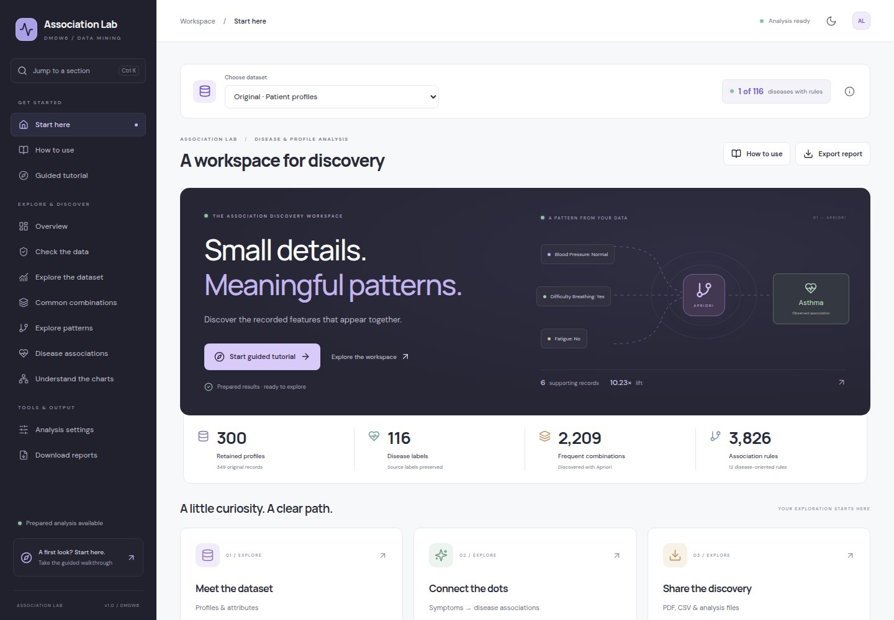

<div align="center">

# Association Lab

### Explore symptoms. See the patterns. Explain the evidence.

A visual academic workspace for Apriori association mining across two independently selectable datasets.

[Start here](#start-here) · [Choose a dataset](#choose-a-dataset) · [Five-minute demo](#your-five-minute-walkthrough) · [Presentation guide](docs/PRESENTATION_GUIDE.md) · [Technical guide](docs/TECHNICAL_GUIDE.md)

</div>



Association Lab discovers recorded features that appear together. Explore charts, select conditions, inspect associations, and download reports without writing filter syntax. Results describe the supplied data; they do not diagnose patients or establish medical causes.

## Start here

### Windows

1. Install Python 3.11 or newer. Enable Python on PATH.
2. Run **`SETUP_PROJECT.cmd`** once to install dependencies. If the frontend needs building, install Node.js 22.12+ first.
3. Run **`START_PROJECT.cmd`** and open **http://127.0.0.1:8000**.
4. Choose a dataset, then open **Overview**, **Disease associations**, or **Start guided tutorial**.

Keep the launch window open while presenting. Do not open `frontend/index.html` directly; the application needs its local server. The prepared analyses are included, so you do not need to rerun mining before exploring.

### Linux / macOS or a fresh source checkout

With Python 3.11+ and Node.js 22.12+ installed:

```bash
python3 -m venv .venv
.venv/bin/python -m pip install -r requirements.txt
npm --prefix frontend ci
npm --prefix frontend run build
.venv/bin/python scripts/launch.py
```

The launcher opens the site at **http://127.0.0.1:8000**. `frontend/dist` is generated locally and is not tracked in Git. Node.js is needed to build the interface, not to view an existing build.

Fonts are bundled locally. Browsing the supplied results needs no external data service after setup. The moon/sun button changes the theme; use your browser's fullscreen mode for projection.

## Choose a dataset

Use **Choose dataset** above any section. Charts, filters, tutorials, settings, and downloads follow the selection. Switching reads saved results; it does not combine sources or run a new analysis.

| | Original · Patient profiles | Extended · Symptoms & diseases |
| :--- | :--- | :--- |
| Source rows | 349 | 4,920 |
| Retained profiles after exact-duplicate removal | 300 | 304 |
| Disease labels in the data | 116 | 41 |
| Recorded symptom types | 4, plus demographic fields | 131; no demographic fields |
| Prepared disease rules | 12 | **1,166** |
| Disease labels with qualifying rules | 1: Asthma | **40 of 41** |

The coverage badge shows the actual number of labels with qualifying rules. A label can exist in the data without passing the current thresholds.

The original raw CSV, saved results, and report remain in their existing locations. The extended source has its own workspace under **`datasets/symptoms/`**. Running the extended analysis updates only that workspace.

The extended benchmark contains many repeated rows. Its 304 retained profiles are not independently verified patients. Only listed symptoms create items; an unlisted symptom is unobserved, not a recorded No. Age, gender, blood pressure, cholesterol, and outcome values are not supplied or invented.

## Your five-minute walkthrough

| Step | Open | Try this |
| :--- | :--- | :--- |
| 1 | Choose dataset | Select **Extended · Symptoms & diseases** and check the **40 of 41** coverage badge. |
| 2 | Overview | Compare disease counts, recorded symptoms, and the coverage ring. |
| 3 | Disease associations | Choose **Dengue** or **Malaria**. Read the conditions, outcome, and supporting-profile count. |
| 4 | Explore patterns | Choose **Skin rash: Yes** under **Contains a condition**. Remove its chip or choose **Reset filters**. |
| 5 | Understand the charts | Select **Dengue** under **Disease in charts**. Switch the ranked bars between **By lift** and **By confidence**. |
| 6 | Download reports | Download the selected dataset's PDF or disease-rules CSV. |

Switch back to **Original · Patient profiles** to inspect its separate results. For that source, try **Fever: Yes** as a condition.

**Start guided tutorial** provides six practical steps. **Try it** opens the working section; **Back to tutorial** returns to the same step. Switching datasets resets the tutorial and source-specific filters.

[View the named association charts](reports/screenshots/named-association-charts.jpg) · [View the extended overview](reports/screenshots/symptom-dataset-overview.jpg)

## Read a result in plain language

A rule reads **conditions → associated observation**. All conditions on the left must occur together.

| Measure | What to check |
| :--- | :--- |
| Supporting profiles | How many retained records contain both sides? |
| Support | How common is the full pattern across the retained data? |
| Confidence | Among profiles matching the conditions, how many also match the outcome? |
| Lift | How common is the outcome among matching profiles relative to its baseline frequency? |

Evidence cards show these values with bars and profile counts. Open **Read this association in plain language** for the worked explanation. High confidence or lift can rest on very few profiles; neither is diagnostic accuracy.

### Read the visualizations

- **Dataset bars:** compare profile counts. Hover for the full label and value.
- **Scatter plots:** each dot is an association. The on-chart key identifies the axes and bubble size; hover for the full pattern.
- **Ranked bars:** the actual conditions and outcome appear beside each bar, rather than “Rule 1”. Use **By lift** or **By confidence** to compare rankings.
- **Combination chart:** each dot represents an itemset; height is its size and bubble size is its profile count.
- **Symptom participation:** counts matching rules containing a recorded symptom, not patients.

## Find your way around

| Section | Purpose |
| :--- | :--- |
| Start here | Visual introduction and a real association |
| How to use | Section guide, chart help, glossary, and FAQs |
| Guided tutorial | Six steps through the working application |
| Overview | Coverage, main statistics, and distributions |
| Check the data | Cleaning flow, column audit, and preparation decisions |
| Explore the dataset | Attribute and category distributions |
| Common combinations | Select and compare recurring groups of items |
| Explore patterns | Select conditions and compare general association rules |
| Disease associations | Inspect rules with a disease label on the right |
| Understand the charts | Compare associations visually and inspect exact metrics |
| Analysis settings | Choose thresholds and rerun the selected source locally |
| Download reports | Download the selected source's reports and data |

Use **Ctrl+K** (**⌘K** on macOS) to jump to a section. On smaller screens, open the navigation menu. Information icons and expandable rows reveal explanations, audit tables, methodology, and exact values when needed.

## Filters or a new analysis?

**Filters change the displayed selection.** Choose a disease, condition, category, or combination item from the available menus. **More filters** includes support, confidence, lift, condition count, symptom group, and row-limit presets. Remove an individual chip or use **Reset filters** to clear the selection.

Tables show **10 rows per page**. **Previous** and **Next** browse the selected rows. **Rows to show** controls the selection limit; **Filtered CSV** exports that whole selection, including its sort order, across all pages.

**Analysis settings change the mining search.** Preset menus provide common values; enable **Custom values** for precise numeric inputs. **Restore defaults** fills the selected source's defaults. **Run analysis** applies them and regenerates only that source's results and report.

| Default | Original profiles | Extended symptoms |
| :--- | ---: | ---: |
| Minimum support | 2%: at least 6 profiles | 1%: at least 4 profiles |
| Minimum confidence | 30% | 30% |
| Minimum lift | 1.20× | 1.20× |
| Maximum itemset size, including both sides | 4 | 3 |
| Export cap, independently per rule family | 20,000 | 5,000 |
| Exact duplicates | Removed | Removed |

The extended defaults find 21,092 general rules before the export cap. Its independent disease-rule cap retains all **1,166** qualifying disease rules. Larger symptom searches are limited to three-item combinations for practical local computation.

Lowering a display filter cannot recover rules excluded during mining. Lower support can find rarer patterns but also admit smaller supporting counts. No matching result is a valid outcome.

## Choose the right download

| Need | Download |
| :--- | :--- |
| A readable presentation or review document | PDF report |
| Disease findings in a spreadsheet | Disease-oriented rules CSV |
| Exported associations in all directions | All association rules CSV |
| The current filtered selection | Filtered CSV on a patterns page |
| Recurring item combinations | Frequent itemsets CSV |
| Prepared source records | Cleaned dataset CSV |
| Snapshot, audit, metrics, and configuration | Complete analysis JSON |
| Editable report text | Academic report in Markdown |

All downloads follow **Choose dataset**. Extended-source filenames start with `symptoms_`. PDF reports cover the source's full saved analysis; filtered CSV follows the selected filters, ordering, and row limit. Files go to your browser's usual download location.

## Sources and preparation

| Source | Attribution | Publisher-listed license |
| :--- | :--- | :--- |
| [Disease Symptoms and Patient Profile](https://www.kaggle.com/datasets/uom190346a/disease-symptoms-and-patient-profile-dataset) | uom190346a, Kaggle version 2 | MIT |
| [Disease Symptom Prediction](https://www.kaggle.com/datasets/itachi9604/disease-symptom-description-dataset) | itachi9604, Kaggle version 2; publisher credits assistance from Pratik Rathod | CC BY-SA 4.0 |

Raw source bytes and acquisition manifests are preserved. The original adapter keeps explicit Yes/No values, groups ages, and excludes Outcome Variable from mining. The extended adapter converts nonempty symptom slots into recorded-presence items and omits empty slots. Both produce one transaction per retained source row.

The extended source is substantially overlapping with other Kaggle symptom benchmarks; those copies are not pooled as independent observations. Its supplemental descriptions, severity weights, and precautions are not treated as patient records. See [source details and attribution](datasets/symptoms/README.md) and [dataset research](docs/DATASET_RESEARCH.md).

## For maintainers

Rebuild the interface after frontend changes:

```bash
npm --prefix frontend ci
npm --prefix frontend run build
```

With the project Python environment active, regenerate one source at a time:

```bash
python scripts/run_pipeline.py --dataset symptoms
python scripts/run_pipeline.py --dataset profiles
```

Running without `--dataset` retains the original profile-source behavior. Do not regenerate the original analysis if you want to preserve its current saved outputs.

For frontend development, start the backend on port 8000 and run `npm --prefix frontend run dev`; Vite proxies `/api` to that backend.

```bash
python -m uvicorn backend.app.main:app --host 127.0.0.1 --port 8000
```

Useful paths:

| Path | Contents |
| :--- | :--- |
| `data/`, `results/`, `reports/`, `REPORT.md` | Original source, saved analysis, and report |
| `datasets/symptoms/` | Separate extended-source data, results, provenance, and report |
| `src/datasets.py`, `src/symptom_pipeline.py` | Source registry and symptom-list adapter |
| `src/pipeline.py`, `src/reporting.py` | Apriori, filtering, and report generation |
| `backend/app/` | Dataset-scoped API and exports |
| `frontend/src/` | Visual interface, filters, tutorial, and chart components |
| `tests/` | Pipeline, API, semantics, metrics, and isolation checks |

Run `python -m pytest -q` for the complete Python suite. The existing source-identity test expects CRLF bytes while this checkout contains LF bytes; that pre-existing checksum failure is documented in the validation notes. The source file has intentionally been left unchanged.

See the [technical architecture and viva handbook](docs/TECHNICAL_GUIDE.md) for diagrams, preprocessing and Apriori internals, worked metrics, API/frontend flows, design tradeoffs, and technical Q&A. The [presentation guide](docs/PRESENTATION_GUIDE.md) covers the live walkthrough; the [current validation record](reports/DATASET_AND_VISUAL_VALIDATION.md) records completed checks.

### Vercel

Import the repository with its root directory unchanged. `vercel.json` builds the frontend, packages both dataset workspaces, and routes `/api/*` to FastAPI. Both prepared sources, filters, and downloads work in the hosted view. Rerunning analysis remains local-only because the hosted function does not provide persistent project storage.

## Troubleshooting

| Problem | Action |
| :--- | :--- |
| Setup or dependencies are missing | Run setup on Windows, or create the Python environment and build the frontend as above. |
| The browser does not open | Keep the server running and visit http://127.0.0.1:8000. |
| Port 8000 is in use | Use the existing app if it is already running, or stop that process before launching another. |
| No matching patterns | Reset the filters or choose another disease. Some labels do not meet the mining thresholds. |
| Extended dataset is unavailable | Restore its supplied workspace or regenerate it with `--dataset symptoms`. |
| CSV has fewer rows than expected | Check the selection limit under More filters. Use Download reports for the complete exported family. |
| Results look stale after a CLI rerun | Restart the server. Reruns from the interface refresh automatically. |
| Run analysis is disabled on the hosted site | Use the local application to generate new results. |

## Interpretation limits

These datasets have unverified clinical provenance and are used for academic exploration. Repeated benchmark rows, rare labels, duplicate policy, thresholds, and related rules affect interpretation. There is no causal identification, held-out clinical validation, or multiple-testing correction. The application has no arbitrary dataset-upload workflow; its two supplied sources remain separate.
