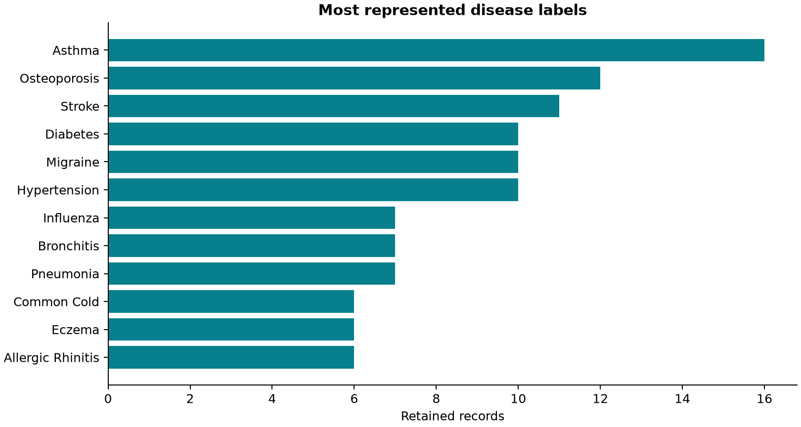
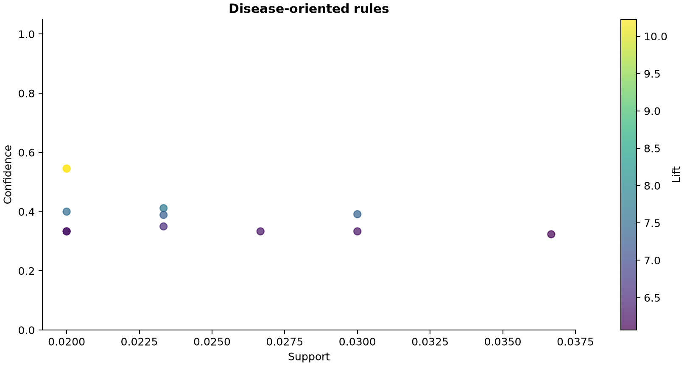

# Association Rule Mining using Apriori on Disease Symptoms and Patient Profiles

DMDW6 | Reproducible academic project

## 2. Abstract

This project applies Apriori association rule mining to the Disease Symptoms and Patient Profile dataset. The source has 349 records and 10 attributes. After documented preprocessing, 300 transactions yield 2209 frequent itemsets, 3826 exported association rules and 12 disease-oriented rules under the current parameters. A local dashboard supports inspection, re-mining and export. The discovered rules represent statistical associations in the dataset and should not be interpreted as medical causation, diagnosis, or clinical recommendations.

## 3. Introduction

Association rule mining identifies recurring combinations of discrete items without fitting a predictive classifier. Healthcare-themed records provide a useful academic setting for exploring symptoms and patient profiles, provided results are interpreted within the dataset.

## 4. Problem Statement

Discover interpretable symptom/profile combinations and their associations with disease labels while preserving data provenance, handling data quality explicitly and exposing the effect of mining thresholds.

## 5. Objectives

Audit source records; clean reproducibly; preserve meaningful item labels; mine frequent itemsets; generate and rank rules with support, confidence and lift; isolate symptom/profile-to-disease rules; provide an interactive dashboard and reproducible exports.

## 6. Dataset Description

Source: https://www.kaggle.com/datasets/uom190346a/disease-symptoms-and-patient-profile-dataset. Kaggle owner uom190346a, version 2, last updated 2024-01-21 according to the saved API metadata; acquired 2026-10-02. Kaggle metadata lists MIT as the license. Original filename: Disease_symptom_and_patient_profile_dataset.csv. Raw SHA-256: 79cd5314cfdefec9b86ee0efd63d3df64a619a2e2511c5908abde008edf1bfa8. There are 116 distinct disease labels. Age ranges from 19 to 90. Four symptom fields are Fever, Cough, Fatigue and Difficulty Breathing. Other attributes are Disease, Age, Gender, Blood Pressure, Cholesterol Level and Outcome Variable. No patient identifiers or independently verified collection protocol accompany this local analysis; authentic clinical provenance and representativeness are not established.

## 7. Data Preprocessing

The workflow is raw data -> audit -> cleaning -> semantic labels -> transactions -> Boolean matrix -> Apriori -> rules -> filtering -> interpretation. The raw CSV is immutable input; every derived file is written separately.

## 8. Data Cleaning

The audit detected 0 missing observations and 49 exact duplicates. The active policy is remove exact duplicates; 49 records were removed. 0 invalid values were mapped to Unknown. Preserve the source CSV byte-for-byte; audit before transformation. Remove exact duplicate rows by default for a unique-profile analysis. Without patient IDs their identity cannot be established; --keep-duplicates provides a sensitivity analysis. Trim whitespace and normalize field names. Standardize categorical case without guessing disease synonyms or expanding truncated labels. Unknown, missing and invalid observations remain Unknown. They are omitted from transactions, never converted into symptom absence. Keep explicit Yes and No symptom items: recorded absence is different from missingness. Bin integer ages into 0-17, 18-30, 31-45, 46-60 and 61+. These are descriptive groups, not clinical risk categories. Exclude Outcome_Variable from all mining because its semantics are insufficiently documented and it could mix downstream outcomes into profile associations. Keep Disease in transactions; primary disease rules have exactly one Disease consequent and no Disease antecedent. Retain truncated disease names and possible aliases separately; flag them for source review instead of inventing corrections.

## 9. Data Labeling and Encoding

Items use Column=Value labels. Yes and No are both retained when explicitly recorded. Missing values do not mean No. Unknown values are retained in the cleaned table and omitted from mining. Age bins are inclusive 0-17, 18-30, 31-45, 46-60, and 61-120 (displayed 61+); only observed groups create items. Original ages remain in the cleaned CSV. Outcome Variable is excluded. preprocessing_metadata.json maps every observed source value to its item and rationale.

## 10. Transaction Representation

One retained row forms one transaction. 300 transactions encode 136 observed items across nine mining fields. The disease label participates as a categorical item. Boolean matrix cells indicate membership only, not numerical severity. Different records can have identical mining transactions after outcome exclusion or age binning; these are retained because they originated from distinct full records.

## 11. Apriori Algorithm

Apriori exploits downward closure: every subset of a frequent itemset must be frequent. It discovers frequent singleton items, joins candidates level by level, prunes candidates with infrequent subsets and counts support. mlxtend.frequent_patterns.apriori runs on the Boolean matrix with an explicit maximum itemset length. This maximum limits exploration, so patterns longer than it are not evaluated.

## 12. Association Rule Mining

Each frequent itemset is partitioned into disjoint, nonempty antecedent and consequent sets. Rules satisfying confidence and lift thresholds are kept. All rules may involve any retained items. Disease-oriented rules require exactly one Disease item on the right and no Disease item on the left. The two exported rule families are capped independently after ranking; all-rules means all qualifying rule directions within the configured search and export limits.

## 13. Evaluation Metrics

Support(A -> B) = count(A union B) / N. Confidence(A -> B) = count(A union B) / count(A). Lift = confidence / support(B). Leverage = support(A union B) - support(A)*support(B). Conviction = (1-support(B))/(1-confidence). Lift above one indicates positive association, not statistical significance. Infinite conviction is represented as null plus conviction_infinite=true in JSON and shown as infinity in the dashboard. For Blood_Pressure=Normal + Difficulty_Breathing=Yes + Fatigue=No -> Disease=Asthma, both sides occur in 6 of 300 records, so support is 0.0200. The antecedent occurs in 11 records, giving confidence 6/11 = 0.5455. The consequent prevalence is 0.0533; confidence divided by this prevalence gives lift 10.2273. This is an in-sample description, not diagnostic accuracy.

## 14. Experimental Setup

Python, pandas, NumPy, mlxtend and FastAPI provide analysis and API; React, Vite and Recharts provide the interface. Current settings: support 0.02, confidence 0.3, lift 1.2, maximum itemset length 4, maximum exported rules per family 20000. At this support, a pattern needs at least 6 retained records. Defaults (0.02, 0.30, 1.20, 4) balance rare disease visibility and a manageable search. These exploratory choices are not clinically validated. The UI limits support to >=0.005 and itemsets to <=5 for bounded local computation. No random sampling is used. A repeat run produces the same ordered statistics except timestamps.

## 15. Results

The run generated 2209 frequent itemsets. There were 3826 general and 12 disease-oriented rules before independent caps; exported counts are 3826 and 12. The dashboard labels 947 exported general rules as strong using confidence >=0.70 and lift >1. This is a descriptive UI threshold, not a significance test. The run timestamp is 2026-10-08T13:52:39.824158+00:00.

## 16. Important Association Rules

| Rank | Antecedent | Disease consequent | Count | Support | Confidence | Lift |
|---|---|---|---:|---:|---:|---:|
| 1 | Blood_Pressure=Normal + Difficulty_Breathing=Yes + Fatigue=No | Disease=Asthma | 6 | 0.0200 | 0.5455 | 10.2273 |
| 2 | Difficulty_Breathing=Yes + Fatigue=No + Fever=Yes | Disease=Asthma | 6 | 0.0200 | 0.5455 | 10.2273 |
| 3 | Difficulty_Breathing=Yes + Fatigue=No | Disease=Asthma | 7 | 0.0233 | 0.4118 | 7.7206 |
| 4 | Cholesterol_Level=Normal + Difficulty_Breathing=Yes + Fatigue=No | Disease=Asthma | 6 | 0.0200 | 0.4000 | 7.5000 |
| 5 | Blood_Pressure=Normal + Difficulty_Breathing=Yes + Fever=Yes | Disease=Asthma | 9 | 0.0300 | 0.3913 | 7.3370 |
| 6 | Age_Group=31-45 + Blood_Pressure=Normal + Difficulty_Breathing=Yes | Disease=Asthma | 7 | 0.0233 | 0.3889 | 7.2917 |
| 7 | Blood_Pressure=Normal + Cholesterol_Level=Normal + Difficulty_Breathing=Yes | Disease=Asthma | 7 | 0.0233 | 0.3500 | 6.5625 |
| 8 | Blood_Pressure=Normal + Cough=Yes + Difficulty_Breathing=Yes | Disease=Asthma | 9 | 0.0300 | 0.3333 | 6.2500 |
| 9 | Cough=Yes + Difficulty_Breathing=Yes + Gender=Female | Disease=Asthma | 8 | 0.0267 | 0.3333 | 6.2500 |
| 10 | Age_Group=31-45 + Cough=Yes + Difficulty_Breathing=Yes | Disease=Asthma | 6 | 0.0200 | 0.3333 | 6.2500 |

## 17. Disease-Oriented Analysis

1 disease labels have qualifying rules. Rare disease labels often cannot reach the support floor. An empty disease panel means no qualifying rule at the current settings, not evidence that the disease has no associations. Rules are ranked by lift, then confidence, then support, with lexical tie breaking. Closely related rules may share most antecedent items; the ranked list is not ten independent discoveries.

## 18. Dashboard

Nine sections cover overview, data quality, exploration, frequent itemsets, all association rules, disease associations, rule visualizations, Apriori parameters and reports/exports. Search and filters operate on the current mined snapshot; lowering a display filter cannot recover rules excluded during mining. Re-run Apriori to change the mining floor. Report and chart exports regenerate after a successful run.

## 19. Discussion

High lift can result from a rare consequent and very small counts; inspect count and support alongside confidence. Profile-only rules can outrank symptom rules. Explicit No items permit absence associations, but their interpretation differs from a present symptom. Removing exact duplicates avoids overweighting repeated profiles for this academic analysis, although repeated legitimate patients cannot be ruled out. The keep-duplicates setting supports comparison.

## 20. Limitations

The discovered rules represent statistical associations in the dataset and should not be interpreted as medical causation, diagnosis, or clinical recommendations. The dataset is small, has many rare labels, truncated names, possible aliases, unknown sampling and unverified clinical provenance. No causal identification, external validation, multiple-comparison correction, uncertainty estimation or held-out evaluation is performed. Rules are descriptive and may be redundant or unstable. The deduplication and binning choices affect support. The original outcome semantics are not inferred. This application is for local academic use and has no authentication or clinical deployment controls.

## 21. Conclusion

A reproducible pipeline and dashboard were implemented for the specified first dataset. Current execution yields 2209 frequent itemsets and 12 disease-oriented rules. Interpretation remains limited to observed associations in the retained records.

## 22. Future Scope

Verify source provenance and aliases; compare deduplication and age-bin choices; examine bootstrap stability and holdout replication; add redundancy pruning and multiplicity-aware significance analysis; evaluate FP-growth for larger datasets. Any clinical application would require an independently designed and validated study.

## 23. References

Dataset: https://www.kaggle.com/datasets/uom190346a/disease-symptoms-and-patient-profile-dataset

mlxtend Apriori documentation: https://rasbt.github.io/mlxtend/user_guide/frequent_patterns/apriori/

mlxtend association rules documentation: https://rasbt.github.io/mlxtend/user_guide/frequent_patterns/association_rules/

Agrawal, R. and Srikant, R. (1994). Fast Algorithms for Mining Association Rules. Proceedings of VLDB.

Provided course reference: references/DMDW6_Dataset_Links_Data_and_How_to_Use.pdf.

Saved source metadata: references/kaggle_metadata.json; acquisition manifest: data/raw/provenance.json.

