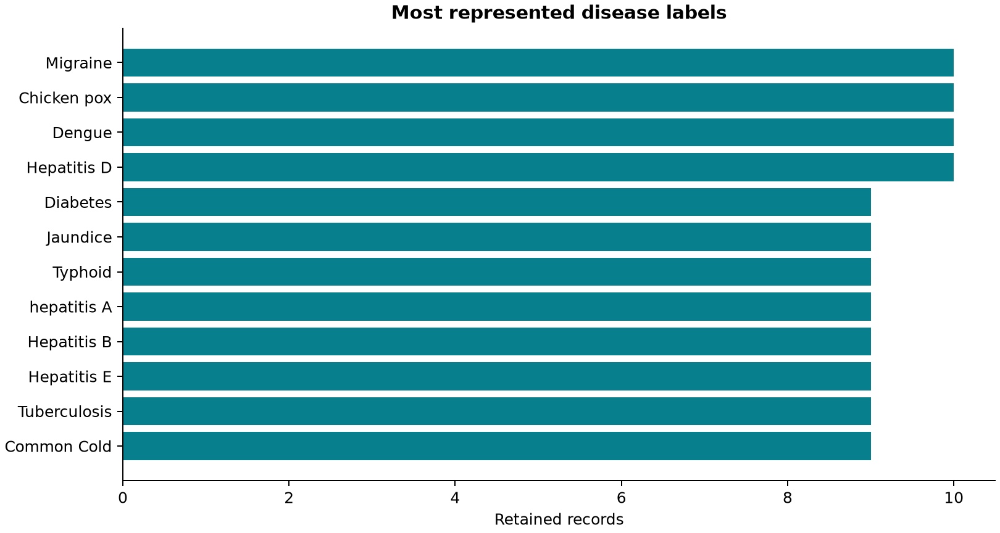
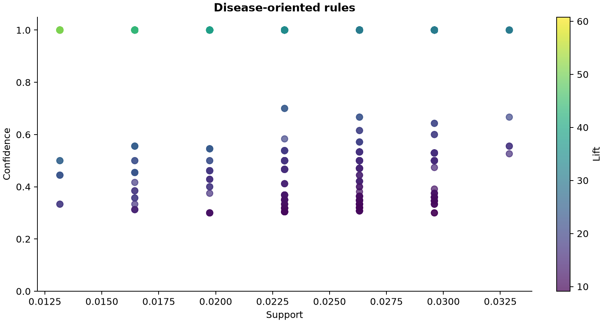

# Association Rule Mining using Apriori on Recorded Disease Symptoms

DMDW6 | Reproducible academic project

## 2. Abstract

Apriori discovers recorded symptom combinations in Disease Symptom Prediction. The 4920 source rows become 304 retained symptom profiles, producing 6192 frequent itemsets and 1166 disease-oriented rules across 40 disease labels. The discovered rules represent statistical associations in the dataset and should not be interpreted as medical causation, diagnosis, or clinical recommendations.

## 3. Dataset Description

Source: https://www.kaggle.com/datasets/itachi9604/disease-symptom-description-dataset. Kaggle owner itachi9604, version 2. Source file: dataset.csv. Acquired 2026-10-26. Publisher-listed license: CC BY-SA 4.0 (as listed by the publisher). Raw SHA-256: ebbd391c4ba4d64f57a00eb3d0a55f0ca9b920b0c5de6b9af4234e72519c9618. The source has a Disease column and 17 symptom slots. The retained data has 41 disease labels and 131 distinct symptom types. No age, gender, blood pressure, cholesterol, or outcome fields are supplied. This educational benchmark has unverified clinical provenance; repeated rows are not independently verified patients.

## 4. Data Quality and Cleaning

There are 4616 exact duplicate source rows. The selected policy is remove exact duplicates; 4616 rows were removed. Blank symptom slots are unfilled list positions, not recorded absence and not a basis for imputing No. Preserve the downloaded dataset.csv byte-for-byte in this dataset workspace. Remove exact duplicate source rows by default; repeated benchmark profiles are not independent clinical evidence. Trim disease labels and symptom names. Preserve disease spellings rather than inventing alias corrections. Convert each nonempty symptom slot to a readable symptom=Yes item; each symptom appears at most once per transaction. An empty symptom slot contributes no item. An unlisted symptom is unobserved, not a recorded No. Do not create age, gender, blood pressure, cholesterol, outcome, or negative symptom observations: the source does not supply them. Keep one Disease item in each transaction; disease rules have one Disease consequent and none in their antecedents. Keep this source and its analysis separate from the original patient-profile dataset and from overlapping Kaggle copies.

## 5. Data Labeling and Encoding

Every retained row contributes one transaction containing its disease and each listed symptom once. Symptoms use readable symptom_name=Yes labels. Empty slots contribute no item. A symptom not listed in the source is unobserved, not No. No demographic fields or negative symptoms are fabricated. The cleaned CSV preserves the symptom-slot structure; transactions and the Boolean matrix are separate exports.

## 6. Apriori and Association Rules

Apriori uses downward closure to enumerate frequent itemsets. A rule partitions an itemset into nonempty, disjoint left and right sides. Disease-oriented rules require one Disease item on the right and none on the left. Combinations are limited to three items for this larger symptom vocabulary. This is descriptive association mining, not a trained diagnostic classifier.

## 7. Experimental Setup

Support 0.01, confidence 0.3, lift 1.2, maximum itemset size 3, and export cap 5000 independently per rule family. At least 4 retained profiles must support a combination. This dataset's defaults are 1% support, 30% confidence, lift 1.20, maximum size 3, export cap 5,000, and exact-duplicate removal. Running this source writes only its own dataset workspace.

## 8. Evaluation Metrics

Support is the share of retained profiles containing both sides. Confidence is the share of left-side matches also containing the right side. Lift is confidence divided by the right-side prevalence. These are sample associations, not diagnostic accuracy or statistical significance. For altered_sensorium=Yes -> Disease=Paralysis (brain hemorrhage), both sides occur in 4 of 304 records, so support is 0.0132. The antecedent occurs in 4 records, giving confidence 4/4 = 1.0000. The consequent prevalence is 0.0164; confidence divided by this prevalence gives lift 60.8000. This is an in-sample description, not diagnostic accuracy.

## 9. Results

Found 6192 frequent itemsets, 21092 general rules, and 1166 disease-oriented rules before independent export caps. Exported counts are 5000 general rules and 1166 disease rules covering 40 of 41 labels. Generated 2026-10-26T11:13:46.395988+00:00.

## 10. Important Association Rules

| Rank | Antecedent | Disease consequent | Count | Support | Confidence | Lift |
|---|---|---|---:|---:|---:|---:|
| 1 | altered_sensorium=Yes | Disease=Paralysis (brain hemorrhage) | 4 | 0.0132 | 1.0000 | 60.8000 |
| 2 | blackheads=Yes | Disease=Acne | 4 | 0.0132 | 1.0000 | 60.8000 |
| 3 | bladder_discomfort=Yes | Disease=Urinary tract infection | 4 | 0.0132 | 1.0000 | 60.8000 |
| 4 | continuous_feel_of_urine=Yes | Disease=Urinary tract infection | 4 | 0.0132 | 1.0000 | 60.8000 |
| 5 | dehydration=Yes | Disease=Gastroenteritis | 4 | 0.0132 | 1.0000 | 60.8000 |
| 6 | dischromic_patches=Yes | Disease=Fungal infection | 4 | 0.0132 | 1.0000 | 60.8000 |
| 7 | extra_marital_contacts=Yes | Disease=AIDS | 4 | 0.0132 | 1.0000 | 60.8000 |
| 8 | foul_smell_of_urine=Yes | Disease=Urinary tract infection | 4 | 0.0132 | 1.0000 | 60.8000 |
| 9 | muscle_wasting=Yes | Disease=AIDS | 4 | 0.0132 | 1.0000 | 60.8000 |
| 10 | nodal_skin_eruptions=Yes | Disease=Fungal infection | 4 | 0.0132 | 1.0000 | 60.8000 |

## 11. Interpretation and Limits

The discovered rules represent statistical associations in the dataset and should not be interpreted as medical causation, diagnosis, or clinical recommendations. Removing duplicates substantially reduces the benchmark. High confidence or lift can rest on very few distinct symptom profiles. Some diseases may not meet the support floor. Closely related rules are redundant, and results have no held-out clinical validation. The source overlaps heavily with other Kaggle symptom benchmarks; do not pool those copies as independent evidence.

## 12. Dashboard and Exports

The dataset selector switches the displayed source. Charts, filters, tutorials, settings, and downloads follow that selection. This report covers only this dataset’s complete saved analysis; filtered CSV follows its selected rules and row limit. Original course data and reports remain in their existing workspace.

## 13. References

Dataset: https://www.kaggle.com/datasets/itachi9604/disease-symptom-description-dataset

Attribution: itachi9604, Disease Symptom Prediction, Kaggle version 2; publisher-listed CC BY-SA 4.0. Acquisition manifest: datasets/symptoms/data/raw/provenance.json.

mlxtend Apriori: https://rasbt.github.io/mlxtend/user_guide/frequent_patterns/apriori/

mlxtend association rules: https://rasbt.github.io/mlxtend/user_guide/frequent_patterns/association_rules/
