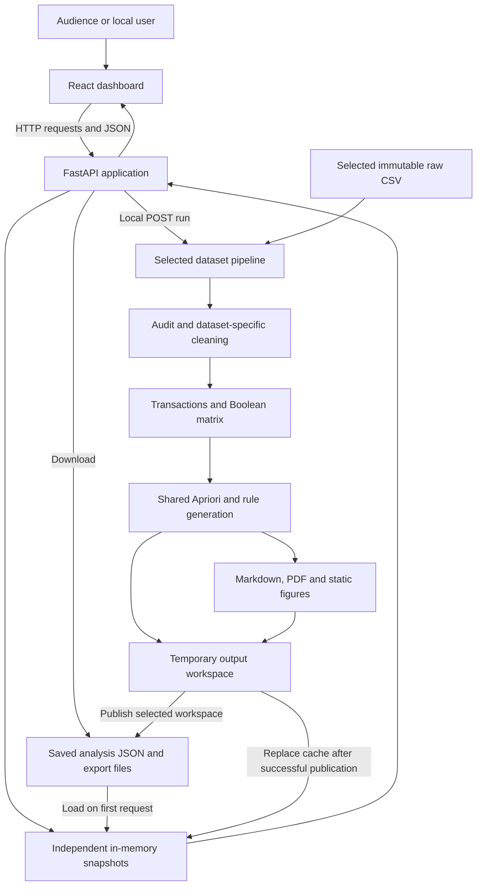
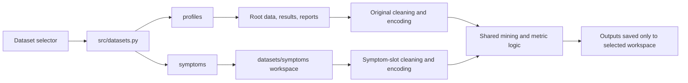
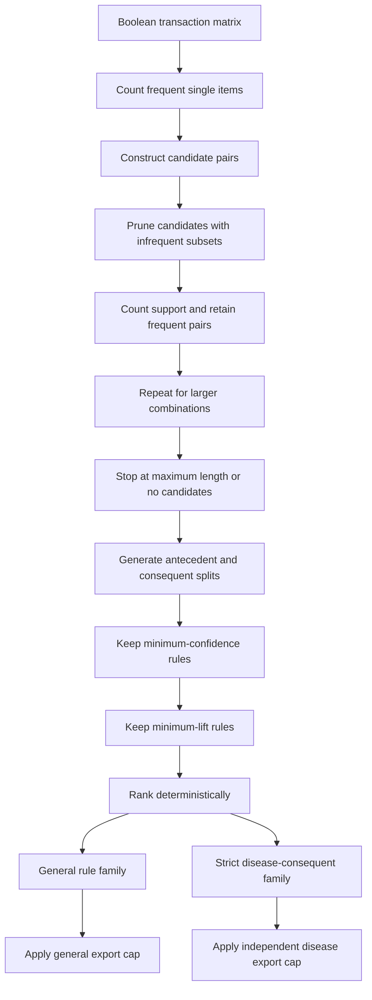
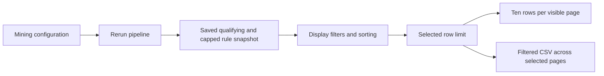
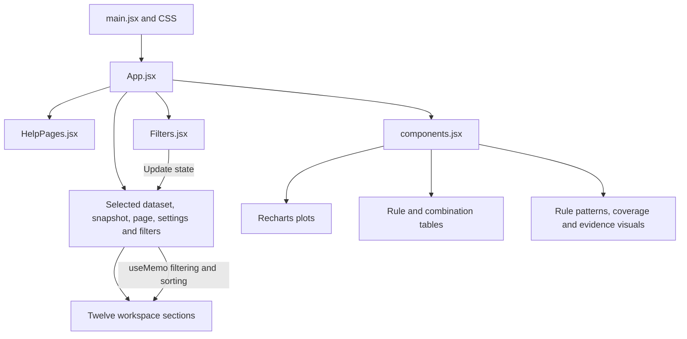
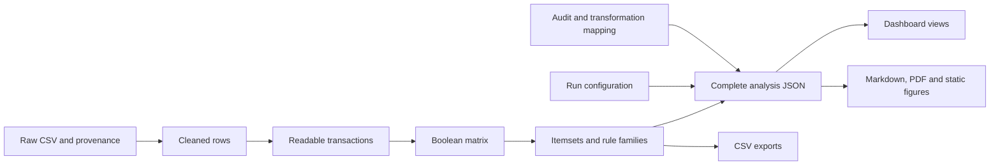
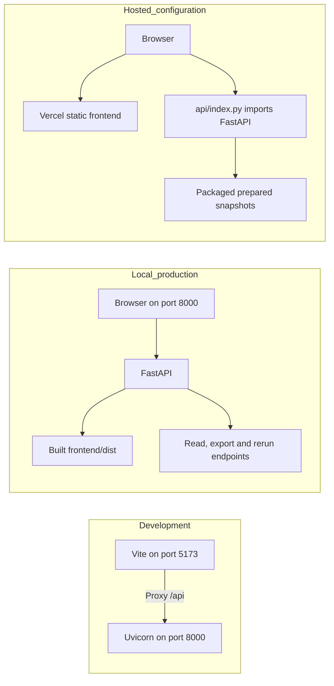

# Association Lab: architecture, technical working, and viva handbook

[Back to README](../README.md) · [Demo walkthrough](PRESENTATION_GUIDE.md) · [Validation record](../reports/DATASET_AND_VISUAL_VALIDATION.md)

This guide explains the implemented project, rather than a proposed architecture. Read sections 1–8 to understand the analysis, sections 9–15 to understand the application, and sections 16–19 to prepare for technical questions. Diagrams use Mermaid, which GitHub can render directly; the surrounding text also explains each flow.

Quick navigation: [Architecture](#2-architecture-what-talks-to-what) · [Stack](#3-technology-stack-and-why-it-was-chosen) · [Datasets](#4-two-datasets-why-separate-and-what-changes) · [Apriori](#7-apriori-underneath-the-interface) · [Metrics](#8-metrics-know-these-calculations) · [API](#10-backend-requests-contracts-caches-and-files) · [Reruns](#11-rerunning-safely-staging-and-publication) · [Frontend](#12-frontend-how-the-interface-is-assembled) · [Tradeoffs](#17-design-decisions-advantages-disadvantages-and-alternatives) · [Viva Q&A](#18-likely-technical-questions-and-answers)

## 1. The project in one minute

**Association Lab discovers recurring combinations of symptoms and patient characteristics, measures their association with disease labels, and lets a user explore and export the evidence.**

The technique is **association rule mining using Apriori**. A rule such as:

```text
Blood pressure: Normal AND Difficulty breathing: Yes AND Fatigue: No
                                ↓
                           Disease: Asthma
```

means that these conditions co-occur in the supplied records. The arrow describes a conditional association. It does not establish temporal order or causation.

A concise presentation answer:

> “We built a full-stack association-mining dashboard. Python audits and cleans the selected Kaggle dataset, converts each retained profile into a transaction, and uses mlxtend's Apriori implementation to find frequent itemsets. We generate association rules, evaluate support, confidence, and lift, and extract rules whose consequent is a disease. FastAPI serves the prepared results to a React dashboard with charts, filters, dataset selection, and report exports. Local users can rerun the selected dataset with different parameters.”

There is **no classifier training, neural network, diagnostic inference endpoint, or train/test prediction accuracy** in the current application. Although the extended dataset's publisher calls it “Disease Symptom Prediction,” this project uses it for association mining.

## 2. Architecture: what talks to what?



Three layers cooperate:

| Layer | Responsibility | Main files |
|---|---|---|
| Presentation | Navigation, charts, menus, evidence explanations, loading states | `frontend/src/` |
| Service | HTTP endpoints, validation, dataset selection, cached reads, reruns, downloads | `backend/app/main.py` |
| Analysis and persistence | Audit, cleaning, encoding, mining, report generation, CSV/JSON/PDF files | `src/`, `data/`, `results/`, `reports/`, `datasets/symptoms/` |

This is a **single application with separated responsibilities**, not a microservices system. There is no SQL/NoSQL database, message broker, separate model server, or user-account service. Files provide durable storage; Python dictionaries provide process-local read caches.

## 3. Technology stack and why it was chosen

Versions below describe repository declarations, not claims about the latest releases. Exact frontend resolutions live in `frontend/package-lock.json`; Python versions are pinned in `requirements.txt` and `backend/requirements.txt`.

| Technology | What it does here | Advantage | Cost or limitation |
|---|---|---|---|
| Python | Analysis, reports, API implementation | Strong data-science ecosystem; common language across backend and pipeline | CPU-heavy work needs careful execution limits |
| pandas | CSV loading, audits, cleaning, distributions, tables | Expressive operations on tabular data | Data is held in memory |
| NumPy | Numerical handling and finite-value checks | Reliable numerical primitives | Numerical values still require safe JSON conversion |
| mlxtend | `TransactionEncoder`, `apriori`, `association_rules` | Established implementations instead of hand-written mining code | Enumeration can grow rapidly with vocabulary and itemset length |
| FastAPI | API routing, request/response handling, interactive `/docs` | Typed contracts and automatic OpenAPI documentation | Deployment still needs an ASGI runtime |
| Pydantic | `AnalysisConfig` and `RuleFilter` validation | Rejects invalid ranges, fields, and sort choices centrally | Dataset-specific constraints require an additional check |
| Uvicorn | Runs the local ASGI application | Simple local HTTP service | Multiple workers are unsuitable for the current shared-file writer design |
| React 19 | Component-based browser interface | Reusable views and state-driven updates | Large snapshots and many chart points can increase browser work |
| Vite 7 | Development server and production bundling | Fast development, optimized static assets | Production requires an explicit frontend build |
| Recharts 3 | Interactive charts from real analysis values | Integrates with React and supports tooltips | Dense charts need readable limits and labels |
| Lucide React | Navigation and action icons | Consistent visual language | Icons still need text or accessible labels |
| Custom CSS | Layout, responsive behavior, themes | Direct control without another styling framework | Project owns its style consistency |
| Matplotlib | Static report figures using the `Agg` backend | Generates images without a graphical desktop | Rendering adds rerun time |
| ReportLab | PDF layout, tables, and report assembly | Produces a standalone academic deliverable | PDF layout is maintained separately from browser layout |
| pytest and HTTPX/TestClient | Pipeline and API verification | Checks real contracts, calculations, and failure behavior | Browser behavior requires separate browser checks |
| Vercel configuration | Serves the built frontend and prepared API data when deployed | Convenient prepared-result demonstration | Hosted reruns are disabled |

`scikit-learn` is present as a dependency of the analysis environment; this application does not fit a scikit-learn classifier. Local Manrope and DM Sans font files keep the visual interface independent of a font CDN. Installed application data and analytics do not require an external AI API.

## 4. Two datasets: why separate, and what changes?



| Property | Original: `profiles` | Extended: `symptoms` |
|---|---:|---:|
| Kaggle owner / dataset | `uom190346a/disease-symptoms-and-patient-profile-dataset` | `itachi9604/disease-symptom-description-dataset` |
| Publisher-listed license | MIT | CC BY-SA 4.0 |
| Raw rows | 349 | 4,920 |
| Exact duplicate rows | 49 | 4,616 |
| Retained rows at defaults | 300 | 304 |
| Raw columns | 10 | 18 |
| Disease labels | 116 | 41 |
| Symptom representation | Four explicit Yes/No fields | Up to 17 listed symptom slots per row |
| Observed symptom types | 4 | 131 |
| Demographics | Supplied | Not supplied |
| Boolean item columns | 136 | 172 |
| Frequent itemsets | 2,209 | 6,192 |
| General rules before export cap | 3,826 | 21,092 |
| Exported general rules | 3,826 | 5,000 |
| Exported disease rules | 12 | 1,166 |
| Disease labels covered by disease rules | 1: Asthma | 40 of 41 |

These are the **shipped default snapshots**. A local rerun can change counts; the current summary/configuration files describe that rerun.

**Why keep the sources separate?** They have different schemas, different meanings of symptom absence, different disease vocabularies, and different source provenance. Appending them would not automatically create a valid larger clinical sample. Some other Kaggle datasets also overlap substantially with the extended source, so concatenating copies would inflate apparent evidence.

The registry supplies allowed IDs, metadata, defaults, workspace paths, and maximum search sizes. `profiles` remains the default and keeps its original file locations. The extended source writes under `datasets/symptoms/`. Switching or rerunning the extended source does not rewrite the original analysis.

“40 diseases” means **40 labels have qualifying rules at the current defaults**. The extended raw source contains **41 labels**. It does not mean the program was hardcoded to output 40 diseases.

## 5. Preprocessing: making records meaningful

### Original patient profiles

`src/pipeline.py` performs the following steps:

1. Read the CSV as strings with automatic missing-value conversion disabled, so the audit can inspect original markers and spellings.
2. Audit rows, columns, missing markers, exact duplicates, unique categories, numeric summaries, whitespace, case variants, and suspicious disease labels.
3. Remove exact **raw-row** duplicates by default. This is an analytical choice: without patient IDs, identical profiles cannot be proven to represent the same patient. Keeping duplicates is available for comparison.
4. Trim values and normalize column names. Map known symptom categories into Yes/No/Unknown; invalid categorical observations become Unknown and are logged.
5. Preserve disease names, collapsing only case/whitespace variants. Truncated labels and suspected aliases remain separate unless there is an authoritative correction.
6. Validate age as an integer between 0 and 120. Invalid ages become missing. Derive descriptive age groups: 0–17, 18–30, 31–45, 46–60, and 61–120, displayed as `61+`.
7. Exclude `Outcome_Variable` from mining because its meaning is insufficiently established and it could mix downstream outcomes into profile associations. Retain it in the cleaned data.
8. Replace raw Age with Age_Group **for mining only**. Keep the recorded Age in the cleaned CSV.
9. Omit unknown observations from transactions; retain both explicit symptom Yes and explicit symptom No.

**Why age bins?** Exact ages fragment support across many values. Bins make recurring groups easier to discover. Their disadvantage is information loss and sensitivity to chosen boundaries. They are descriptive groups, not medical risk bands.

Two distinct original records can become identical transactions after age binning or outcome exclusion. The pipeline retains those separately; it does not silently deduplicate again after transformation.

### Extended symptom lists

`src/symptom_pipeline.py` expects exactly `Disease` and `Symptom_1` through `Symptom_17`:

1. Audit and optionally remove exact raw-row duplicates.
2. Trim disease labels and symptom names.
3. Convert each nonempty listed symptom into a named presence item, such as `skin_rash=Yes`.
4. Use a set so a repeated symptom in one profile contributes only once.
5. Reject invalid names or ambiguous normalization collisions instead of merging unrelated symptoms silently.
6. Require a recorded disease and at least one symptom per profile.
7. Create no age, gender, blood pressure, outcome, or negative-symptom observations.

**The important distinction:** an empty symptom slot means no listed item in that slot. It does not establish that all other symptoms were assessed and absent. Large empty-slot counts in this source are partly a consequence of its variable-length list format, not the same thing as thousands of missing patient measurements.

## 6. Transactions and Boolean encoding

A transaction is one retained profile expressed as a set of readable items:

```text
Original example:
{Fever=Yes, Cough=No, Fatigue=No, Difficulty_Breathing=Yes,
 Gender=Female, Blood_Pressure=Normal, Cholesterol_Level=Normal,
 Age_Group=31-45, Disease=Asthma}

Extended example of the representation:
{skin_rash=Yes, itching=Yes, Disease=Fungal infection}
```

These examples explain the format; they are not additional records inserted into the source.

`TransactionEncoder` makes a Boolean matrix: rows are retained profiles, columns are distinct items, and `True` means the transaction contains that item.

| Transaction | Fever=Yes | Fever=No | Cough=Yes | Disease=Asthma |
|---|---:|---:|---:|---:|
| Illustrative T1 | True | False | True | True |
| Illustrative T2 | False | True | True | False |
| Illustrative T3, fever unknown | False | False | True | False |

A `False` in the `Fever=Yes` column means the **item is absent from the transaction**. It is not sufficient to conclude that the clinical answer was No. In the original source, recorded No has its own `Fever=No` column; unknown fever sets neither item. The extended source has only recorded-presence symptom items.

This is categorical one-hot-style encoding, not embeddings or standardized numerical features. It avoids accidentally treating category names as ordered numbers.

Do not confuse **fields** with **items**. The original miner uses nine logical fields, but their observed categories produce 136 distinct item columns. The extended summary counts 131 symptom types plus the Disease field as 132 mining features; those symptom-presence items plus 41 disease-category items produce 172 Boolean columns. The two summaries describe different source representations; the encoded matrix is the actual common input to Apriori.

## 7. Apriori underneath the interface

### Frequent itemsets first, rules second

An **itemset** is an unordered combination, such as `{Fever=Yes, Cough=Yes}`. A **rule** divides a frequent combination into nonempty left and right sides, such as `Fever=Yes → Cough=Yes`.



The main pruning principle is **downward closure**: if an itemset is frequent, every subset must be frequent. Equivalently, an infrequent set cannot have a frequent superset, because adding conditions cannot increase the number of matching transactions.

For example, if `{A, B}` occurs below minimum support, `{A, B, C}` cannot qualify. Apriori can avoid exploring that branch. This property applies to support, not generally to lift or confidence.

The project calls `mlxtend.frequent_patterns.apriori` with `use_colnames=True` and `max_len` from configuration, then calls `association_rules` using a confidence threshold. It filters lift afterward. It does not implement a custom Apriori engine.

### General rules versus disease rules

General rules can include symptom-to-symptom associations, profile associations, or a disease on the left. A disease rule must satisfy both conditions:

```python
len(consequents) == 1 and consequents[0].startswith('Disease=')
# and no antecedent starts with Disease=
```

Therefore `Disease=Asthma → Cough=Yes` is a possible general rule but is excluded from the disease family. Multiple conditions on the left are combined with AND.

Rules rank by descending lift, then confidence, then support, then lexical item labels for deterministic ties. General and disease families have **independent caps after ranking**. Extracting disease rules before capping the general family prevents high-ranking unrelated rules from hiding disease associations.

The export cap reduces saved/browser payload size; it does **not** prevent the earlier enumeration and calculation of qualifying rules. The extended source records the pre-cap count of 21,092 general rules even though only 5,000 are exported.

### Complexity and algorithm choice

For a vocabulary of `m` items, there are up to `2^m - 1` nonempty itemsets before constraints. Apriori avoids many candidates through support pruning, but low support, long transactions, and large maximum lengths can still make it expensive. It is not accurate to describe its general worst-case complexity as simply linear or quadratic.

**Why Apriori?** It matches the project's data-mining objective, provides transparent combinations, and works for these bounded educational datasets. **Disadvantage:** candidate growth can be substantial. FP-growth is a sensible future comparison because it compresses transactions into a prefix-tree-based representation and avoids Apriori-style candidate generation; the current project does not implement it.

## 8. Metrics: know these calculations

Let `N` be retained records, `A` the complete antecedent, and `B` the complete consequent. `count(A ∩ B)` means records containing every item on both sides.

| Metric | Formula | Interpretation |
|---|---|---|
| Antecedent support | `count(A) / N` | How often the left conditions occur |
| Consequent support | `count(B) / N` | Baseline frequency of the right side |
| Rule support | `count(A ∩ B) / N` | How often the complete association occurs |
| Confidence | `count(A ∩ B) / count(A)` | Fraction of left-matching records also matching the right |
| Lift | `confidence / support(B)` | Conditional frequency relative to the baseline |
| Leverage | `support(A ∩ B) - support(A) × support(B)` | Absolute departure from independence |
| Conviction | `(1 - support(B)) / (1 - confidence)` | Compares expected and observed rule failures; denominator can be zero |

Lift above 1 indicates positive association in this dataset; 1 corresponds to independence by this measure; below 1 indicates negative association. **Lift 10 does not mean 1,000% disease probability.** Confidence is conditional frequency within the supplied sample, not a clinically validated probability for a new person.

### Real original-dataset example

For the leading shipped disease rule:

```text
Blood_Pressure=Normal + Difficulty_Breathing=Yes + Fatigue=No
    → Disease=Asthma

N = 300
count(A) = 11
count(B) = 16
count(A ∩ B) = 6

Support    = 6 / 300                = 0.02       = 2%
Confidence = 6 / 11                 ≈ 0.54545    = 54.55%
Lift       = (6 / 11) / (16 / 300)   ≈ 10.22727
Leverage   = 0.02 - (11/300 × 16/300) ≈ 0.01804
Conviction = (1 - 16/300)/(1 - 6/11) ≈ 2.08267
```

The impressive lift rests on **six supporting profiles**. Always explain the count alongside the ratio.

### Real extended-dataset example

`altered_sensorium=Yes → Disease=Paralysis (brain hemorrhage)` has four antecedent matches, four joint matches, and five consequent matches among 304 retained profiles:

```text
Support = 4/304 ≈ 1.316%
Confidence = 4/4 = 100%
Lift = 1/(5/304) = 60.8
```

This is perfect confidence in four observed matches, not proof of diagnostic reliability. Its conviction is infinite. Because JSON cannot represent Infinity or NaN safely, the output uses `conviction: null` and `conviction_infinite: true`; the interface can display `∞`. Other undefined metrics are serialized as null. Additional mlxtend metrics, including Jaccard, Zhang's metric, certainty, and Kulczynski, are retained in exported rules; the primary explanation centers on support, confidence, lift, leverage, and conviction.

The dashboard's **Strong rules** count means `confidence >= 0.70` and `lift > 1` among exported general rules. This is a descriptive threshold, not a p-value or significance test.

## 9. Parameters: what each decision changes

| Setting | Original default | Extended default | Effect and tradeoff |
|---|---:|---:|---|
| Minimum support | 0.02 | 0.01 | Higher removes rare patterns and reduces search; lower improves rare-label coverage but increases computation and unstable patterns |
| Minimum confidence | 0.30 | 0.30 | Higher requires more consistent conditional matches, but can miss useful weaker associations |
| Minimum lift | 1.20 | 1.20 | Requires positive association above baseline; high lift can still be driven by rare labels |
| Maximum itemset size | 4 | 3 | Bounds both sides together; longer rules may be more specific but cost more and rely on fewer records |
| Maximum exported rules per family | 20,000 | 5,000 | Limits output size after ranking; may omit lower-ranked rules |
| Remove exact duplicates | Yes | Yes | Limits repeated-profile weighting; may remove legitimately separate people with identical records |

At defaults, support requires at least `ceil(0.02 × 300) = 6` original records and `ceil(0.01 × 304) = 4` extended records. The small numerical tolerance used in code prevents floating-point boundary errors.

The configuration model permits support from 0.005 to 1, confidence from 0 to 1, lift from 0 to 1,000, maximum itemset size from 2 to 5, and exported-rule limits from 1 to 100,000. The extended registry adds a stricter maximum itemset size of **3**, while the original supports up to **5**. Larger vocabulary makes the extended search more expensive despite its similar retained row count.

A three-item disease rule can have at most two antecedent items plus the disease item. “Maximum itemset size” and “maximum antecedent length” are different settings.

### Display filtering is different from mining



Changing a display filter is fast because it examines existing rules. Lowering a display threshold cannot retrieve a rule omitted by the previous mining thresholds or export cap. Change the mining configuration and rerun to change the search itself.

## 10. Backend: requests, contracts, caches, and files

The canonical dataset-specific prefix is:

```text
/api/datasets/{dataset_id}
```

Examples:

| Request | Responsibility |
|---|---|
| `GET /api/datasets` | Catalog, readiness, per-source defaults, and `can_run` |
| `GET /api/health` | Service status, original snapshot readiness, writer status |
| `GET /api/datasets/symptoms/analysis` | Complete selected snapshot with registry metadata |
| `GET .../dataset/summary` | Current analytical counts |
| `GET .../dataset/columns` | Source-column audit |
| `GET .../dataset/missing-values` | Missing counts by raw column |
| `GET .../dataset/distribution` | Retained categorical distributions |
| `GET .../apriori/itemsets` | Filter saved frequent itemsets |
| `GET .../apriori/rules` | Filter general rules |
| `GET .../apriori/rules/disease` | Filter disease rules |
| `GET .../apriori/top-rules` | Ranked selection of the chosen family |
| `GET .../apriori/metrics` | Summary and metric definitions |
| `POST .../apriori/filter` | Rule filtering from a validated JSON body |
| `POST .../apriori/run` | Locally regenerate the selected analysis and reports |
| `GET .../export/rules` | Filtered CSV respecting family, sorting, and selected limit |
| `GET .../export/{kind}` | Complete prepared attachment |

The `...` in the table means the selected dataset prefix above. Legacy routes such as `/api/analysis` and `/api/apriori/rules` retain the original source as their default. Interactive schemas are available at `http://127.0.0.1:8000/docs`.

Example requests:

```bash
curl 'http://127.0.0.1:8000/api/datasets/symptoms/apriori/rules/disease?disease=Dengue&top_n=10'
curl 'http://127.0.0.1:8000/api/datasets/symptoms/export/rules?disease_only=true&item=skin_rash%3DYes&top_n=50'
curl -X POST 'http://127.0.0.1:8000/api/datasets/symptoms/apriori/run' \
  -H 'Content-Type: application/json' \
  -d '{"min_support":0.01,"max_itemset_size":3}'
```

Omitted run fields use the **selected dataset's defaults**, not the defaults of another source. `AnalysisConfig` and `RuleFilter` forbid extra fields. Dataset IDs and export kinds are allowlisted before constructing file paths; a request cannot choose an arbitrary local file.

| Status | Example meaning |
|---|---|
| 400 | A run encounters invalid source data or a missing input file |
| 404 | Unknown dataset, unknown export kind, or absent export file |
| 409 | Another analysis currently owns the writer lock |
| 422 | Invalid request value or unsupported dataset search length |
| 503 | No prepared analysis exists for the requested source |
| 501 | Hosted deployment does not support reruns |

### What is inside a snapshot?

`analysis.json` combines `summary`, `config`, `quality`, `cleaning`, `distributions`, `itemsets`, `rules`, `disease_rules`, `symptoms`, and `mapping`. Extended snapshots also include source metadata and symptom counts. The API attaches registry metadata for either source.

The first read loads a source's JSON from disk into memory. Later reads reuse its cached dictionary. The original uses the backward-compatible `state` variable; extended snapshots use `dataset_states`, keyed by root path and source ID. A successful API rerun replaces the selected cache. A CLI rerun does not notify an already-running server, so restart that server to reload its saved snapshot.

**Why a complete snapshot?** One coherent analysis is easy for the dashboard to load and explore without repeated requests. The disadvantage is response size and browser memory. The extended JSON is compactly serialized, and default output caps keep it within the project's tested hosted payload budget of 4,500,000 bytes. This is a tested project budget, not a guarantee for every custom configuration or future hosting limit.

## 11. Rerunning safely: staging and publication

```mermaid
sequenceDiagram
    participant UI as React
    participant API as FastAPI
    participant Lock as Shared writer lock
    participant Temp as Temporary workspace
    participant Disk as Selected saved files
    participant Cache as Selected cache
    UI->>API: POST selected source configuration
    API->>API: Validate source, defaults, ranges and mode
    API->>Lock: Try acquire without waiting
    alt Writer already busy
        API-->>UI: 409 conflict
    else Writer acquired
        API->>Temp: Clean, encode, mine and generate report
        alt Computation or report generation fails
            API-->>UI: Error; previous snapshot remains
        else Staging succeeds
            API->>Disk: Publish output files using replacement
            API->>Cache: Replace completed selected snapshot
            API-->>UI: Success and summary
            UI->>API: Reload catalog and selected analysis
        end
        API->>Lock: Release in finally block
    end
```

A process-local `threading.Lock` admits one writer across both sources. It also protects shared report rendering. Readers can keep using their previous cached analysis while calculation happens. FastAPI's synchronous handlers run through its normal synchronous execution path; the UI waits for the POST response. There is **no durable background job, progress queue, or task-status polling system**. A loading message means the request is pending, not that percentage progress is being measured.

Outputs are computed in a temporary folder before publication. Each destination file is copied to a `.new` file and replaced; the selected cache is updated after publication. Raw inputs are not part of publication.

**Limits of this design:** per-file replacement is atomic, but the whole folder is not a transaction. A failure halfway through publication can leave mixed generations on disk even though the old cache remains. Simultaneous file downloads can observe different generations. The lock does not coordinate multiple worker processes or a separately launched CLI process. Use one local server process and avoid concurrent CLI writes. A production design would use versioned output directories and an atomic active-version pointer, plus a durable job/locking mechanism.

## 12. Frontend: how the interface is assembled



| File | Role |
|---|---|
| `frontend/src/main.jsx` | Mounts React and imports the style layer |
| `frontend/src/App.jsx` | Coordinates API reads, dataset selection, navigation, filters, settings, reruns, and page composition |
| `frontend/src/components.jsx` | Reusable panels, charts, rule labels, pagination, metrics, fields, evidence visuals, and formatting |
| `frontend/src/Filters.jsx` | Dataset-derived menu choices, presets, exact item selection, active chips, and reset controls |
| `frontend/src/HelpPages.jsx` | Welcome, usage guidance, source-aware tutorial, terminology, and explanations |
| `frontend/src/styles.css` | Visual theme, layouts, responsive rules, and interaction styling |
| `frontend/vite.config.js` | React plugin, development API proxy, and separate charts bundle |

The interface uses React hooks rather than Redux or a separate global state package:

- `useState` tracks visible page, source, data, filters, configuration, loading, and theme.
- `useEffect` performs initial loading, theme application, keyboard listeners, and toast cleanup.
- `useMemo` derives filtered/sorted rules and itemsets from the current snapshot.
- `useRef` tracks request sequence and modal focus targets.

Navigation selects a page within the application; the project does not use a React Router route for each workspace section. This is simple for a contained dashboard, but does not provide dedicated URLs for each section/filter state. The theme is held in React state; it is not saved as a user account preference.

### What happens when a dataset is switched?

1. Set the loading state and request both the catalog and selected analysis with `Promise.all`.
2. Use a sequence number to ignore a response superseded by a newer load.
3. Update the active dataset only after the required requests succeed.
4. Keep the selected section but reset source-dependent filters, tutorial progress, rankings, and configuration controls.
5. Disable source changes during loading/running and make stale content inert while loading.
6. If loading fails, retain the previous successful source and display an error.

Every analysis/download URL uses the active dataset prefix. This prevents showing an extended chart while accidentally downloading an original report.

### Filters, pagination, and exports

Most interactive rule filtering happens **in the browser on the loaded snapshot**. The backend implements corresponding filtering for API clients and filtered CSV downloads. Both use exact item membership for condition selection, so choosing one item cannot accidentally match another item with a similar substring.

The order is filter → sort → selected row limit → visible table page. Tables show ten rows per page. A limit of 50 means five pages of ten, and the filtered CSV includes all 50 selected rows. Full report downloads serve the complete saved family, subject to the mining export cap.

**Tradeoff:** browser filtering feels immediate for the shipped snapshots, but duplicates some backend logic and becomes less appropriate for very large results. Export-parity checks help detect divergence. A larger system should use server-side pagination/filtering and smaller response contracts.

### Why the visual changes matter technically

Actual condition/outcome labels replace meaningless “Rule 1” chart labels. Support/count evidence appears next to ratio metrics. Native selects expose available choices without requiring the audience to know encoded field names. Long methodology and audit text stays available in expandable sections. Scatter plots, ranking bars, coverage visuals, and tables are different views of the same analytical snapshot; the charts do not perform an independent analysis.

Accessibility features include labels, keyboard navigation, visible loading/error/empty states, a skip link, modal focus handling, and responsive layouts. Local fonts support an offline demonstration after installation/build.

## 13. Reports, outputs, and traceability



| Output | Purpose |
|---|---|
| `data/raw/` | Preserved CSV and provenance |
| `data/processed/cleaned_dataset.csv` | Inspectable cleaned source rows |
| `data/intermediate/transactions.json` / `.csv` | Human-readable items per profile |
| `data/intermediate/encoded_transactions.csv` | Boolean matrix actually passed to mining |
| `results/data_quality.json` | Original-source audit |
| `results/preprocessing_metadata.json` | Cleaning log and original-value-to-item mapping |
| `results/analysis_config.json` | Parameters used for the current run |
| `results/frequent_itemsets.csv` | Item combinations, supports, counts, and lengths |
| `results/association_rules.csv` | Exported general rule family and metrics |
| `results/disease_rules.csv` | Exported strict disease rule family |
| `results/summary.json` | Counts, timestamp, source, raw hash, and cap counts |
| `results/analysis.json` | Dashboard's complete prepared snapshot |
| `REPORT.md` | Generated academic report |
| `reports/DMDW6_Report.pdf` and figures | Portable report and static charts |

Paths above are relative to the selected workspace. For the extended source, prefix them with `datasets/symptoms/`.

`src/reporting.py` uses the already-computed analysis object, generates Matplotlib figures, and assembles Markdown/PDF with ReportLab. It does not rerun mining independently or introduce a different rule calculation.

The raw hash identifies the exact bytes used; feature mappings explain transformations; configuration records the experiment; counts expose export caps. Deterministic ranking makes repeated analytical outputs comparable. Timestamps and generated document bytes need not be identical between runs.

**Why files rather than a database?** These small, mostly read-only academic snapshots are easy to inspect, version, export, and package. The disadvantages are limited transaction guarantees, weak concurrent-writer support, no built-in query indexing, and no account/history model. A database becomes useful when runs, users, permissions, or data volume grow.

## 14. Development, local production, and hosted execution



Vite transforms JSX and bundles browser assets; it does not execute Python. During development it proxies `/api` to Uvicorn, allowing same-origin frontend requests. For the local built mode, FastAPI mounts `frontend/dist` after registering API routes. Build assets before starting the server so the static mount exists.

The Vercel configuration builds `frontend/dist`, rewrites `/api/*` to `api/index.py`, and packages both datasets' prepared files. When `VERCEL=1`, the catalog reports `can_run=false` and rerun requests return 501. Prepared analysis and downloads remain available. This documents the configured behavior; it does not imply a deployment has been performed.

Using the project's Python environment, the main commands are:

```bash
# From project root: original analysis and reports
python scripts/run_pipeline.py --dataset profiles

# Extended analysis and reports only
python scripts/run_pipeline.py --dataset symptoms

# Build browser assets
npm --prefix frontend ci
npm --prefix frontend run build

# Serve built app and API
python -m uvicorn backend.app.main:app --host 127.0.0.1 --port 8000

# In a separate terminal for frontend development
npm --prefix frontend run dev
```

Use `scripts/run_pipeline.py` for full regeneration. `scripts/run_apriori.py` delegates to the full pipeline; `scripts/preprocess.py` updates only original preprocessing artifacts. Detailed environment setup and Windows launch commands are in the [README](../README.md).

## 15. Source-code map: where to look during questions

| File or symbol | What it explains |
|---|---|
| `src/pipeline.py::AnalysisConfig` | Mining defaults, accepted ranges, extra-field rejection |
| `src/pipeline.py::RuleFilter` | Rule-filter contract and sort whitelist |
| `audit`, `clean`, `encode` | Original-source transformations and transaction semantics |
| `mine` | mlxtend calls, metric normalization, ranking, independent caps |
| `is_disease_rule` | Exact definition of a disease-oriented rule |
| `filter_rules` | Backend thresholds, exact condition matching, sorting, Top N |
| `run_pipeline` | Original full analytical flow and saved outputs |
| `src/datasets.py` | Dataset registry, defaults, and workspace isolation |
| `src/symptom_pipeline.py::prepare_symptoms` | Symptom-slot schema and presence-only interpretation |
| `run_symptom_pipeline` | Extended-source outputs and compact JSON |
| `backend/app/main.py::analysis` | Snapshot loading and per-source caches |
| `backend/app/main.py::run` | Shared lock, temporary staging, publication, cache replacement |
| `backend/app/main.py::export_rules` | Filtered CSV generation |
| `backend/app/main.py::export` | Allowlisted complete file downloads |
| `src/reporting.py::generate_report` | Source-aware Markdown/PDF/figure generation |
| `scripts/run_pipeline.py` | Dataset-aware CLI and default merging |
| `frontend/src/App.jsx::reload` | Successful-switch behavior and stale-response protection |
| `frontend/src/App.jsx::filteredRules` | Browser filtering, sorting, and selected-limit behavior |
| `api/index.py`, `vercel.json` | Hosted entry point and packaging |
| `tests/test_pipeline.py`, `test_api.py`, `test_datasets.py` | Algorithm, API, and isolation checks |

## 16. Testing: what gives confidence, and what does not?

The tests address different failure classes:

| Verification | What it establishes |
|---|---|
| Source identity and schema | Expected input bytes/columns are used |
| Missing/invalid/age-boundary cases | Cleaning semantics are intentional |
| Hand-counted artificial baskets in isolated unit tests | Rule mathematics works on known examples |
| Independent counts for exported real rules | Saved support/confidence/lift agree with encoded records |
| Disease-family checks | No disease antecedents or multi-item disease consequents leak into that view |
| Caps, filters, and deterministic ordering | Output contracts and reproducibility hold |
| API validation and download checks | Requests and exported artifacts behave consistently |
| Staged rerun and failure tests | Selected-source publication and previous-cache behavior work |
| Source-isolation checks | Extended runs preserve original artifacts |
| Production build and browser checks | Actual frontend works across views and screen sizes |

The [current validation record](../reports/DATASET_AND_VISUAL_VALIDATION.md) documents 67 passing API/dataset tests, real browser checks for both sources at 1440/768/390/320 CSS pixels, filtered-export parity, downloads, and an extended rerun that left 18 original artifacts unchanged. These are recorded checks, not a claim that tests were rerun when this guide was written.

The recorded full-suite run had 96 passing tests and one existing original-source identity failure: the test expects CRLF raw bytes, while this checkout has LF bytes. The original snapshot records the historical CRLF hash. The difference is documented rather than hidden by modifying the original data. SHA-256 is byte-sensitive even when parsed table values are identical.

To run checks in an installed environment:

```bash
python -m pytest -q
python -m pytest -q tests/test_api.py tests/test_datasets.py
npm --prefix frontend run build
```

Passing software tests does **not** establish medical validity, causal validity, unbiased sampling, or external predictive accuracy.

## 17. Design decisions: advantages, disadvantages, and alternatives

| Decision | Why it fits this project | Disadvantage | Possible next step |
|---|---|---|---|
| Apriori rather than a classifier | Goal is transparent recurring associations | No validated diagnosis or prediction accuracy | Separate supervised task with appropriate validation if required |
| Separate dataset adapters, shared miner | Preserves source meaning while reusing core calculations | Each new schema needs an adapter | Add adapters with schema/semantic tests |
| Separate dataset workspaces | Protects original results and avoids invalid mixing | More files and source-specific metadata | Registry-driven ingestion with versioned runs |
| Remove exact raw duplicates by default | Reduces repeated benchmark/profile weighting | May remove independent people with identical records | Compare retained-versus-deduplicated sensitivity |
| Explicit Yes and No only when recorded | Keeps absence different from unknown | More columns in original encoding | Preserve this distinction in every future adapter |
| Descriptive age bins | Reduces fragmentation | Boundary choices influence discoveries | Compare alternate binning policies |
| Keep uncertain disease aliases separate | Avoids invented corrections | Splits support across possible synonyms | Add authoritative, auditable mappings |
| Support/confidence/lift thresholds | Interpretable controls over frequency and association | Threshold-sensitive and not significance testing | Stability analysis and held-out replication |
| Source-specific search limits | Makes broader vocabulary practical | Omits longer associations | Benchmark runtime/memory before expanding limits |
| Complete cached snapshot | Simple, coherent, fast interactive reads | Large payloads; process-local cache | Server filtering, pagination, versioned cache |
| Browser filters and selectable presets | Immediate feedback and discoverable choices | Duplicated filter logic and bounded options | Shared contract tests and server-side queries at scale |
| File persistence and staged API runs | Portable academic deliverables with inspectable intermediates | No folder transaction or multi-process coordination | Versioned storage, database metadata, job queue |
| Prepared hosted results, local reruns | Reliable audience demo without hosted computation | Hosted users cannot change mining results | Durable background execution service |
| Custom CSS and local fonts | Consistent visuals and offline presentation | Manual style maintenance | Introduce a larger component system only if needed |

## 18. Likely technical questions and answers

### “Is this supervised or unsupervised learning?”

Apriori is generally classed as unsupervised association mining: it discovers co-occurring items rather than fitting a labeled classifier. We include recorded Disease as an item, then select disease-consequent rules for an outcome-oriented view. That restriction does not turn the application into a trained diagnostic classifier.

### “Where is the model file? Is anything trained?”

There is no `.pkl` classifier or neural-network checkpoint. The reusable analytical artifact is the frequent-itemset/rule snapshot with metrics and configuration. A rerun recomputes those patterns from transactions.

### “Why did the original only show Asthma?”

At its defaults, a complete association needs at least six of 300 retained records, plus the confidence/lift constraints and maximum length. With 116 imbalanced labels, only Asthma has qualifying disease-consequent rules. It is a data-and-threshold result, not an Asthma-only hardcoded model.

### “Why does the new dataset show more diseases with almost the same retained row count?”

It has 41 rather than 116 disease labels, a much broader symptom vocabulary, different co-occurrences, and a lower default support requiring four rather than six records. Coverage depends on label frequency, features, thresholds, and search limits, not raw row count alone. These are different datasets, so the coverage comparison is not a controlled algorithm benchmark.

### “Why does one of the 41 labels have no disease rule?”

No rule for that label meets all current thresholds and search constraints in the retained data. Missing rule coverage does not mean the disease is absent from the source or medically unrelated to symptoms. Investigate its frequency and rerun sensitivity before attributing one specific cause.

### “Is 100% confidence the same as 100% accuracy?”

No. It means every antecedent-matching record in this sample also contains the consequent. Four matches can produce 100% confidence. Predictive accuracy would need a defined prediction procedure and evaluation on unseen examples.

### “Why use lift if confidence already exists?”

Confidence ignores how common the consequent already is. Lift compares the conditional frequency with that baseline. A high confidence for a very common label may add little information; lift helps expose that. Support/counts remain essential because rare labels can produce very high lift.

### “Can I compare support directly across the two datasets?”

You can compare the fraction numerically, but its substantive meaning depends on each source's sampling, deduplication, and symptom semantics. The two sources do not establish comparable population prevalence.

### “Does lowering support always help?”

It can reveal rarer patterns and more disease labels, but expands the candidate search and admits patterns supported by fewer records. It changes the evidence threshold; it is not an automatic quality improvement.

### “Why not merge the datasets or add every Kaggle copy?”

Their schemas and missingness semantics differ, and some candidates duplicate benchmark transactions. Uncontrolled merging can create false negatives, fabricated demographics, or repeated evidence. A valid merge needs compatible definitions, provenance, label mapping, and overlap analysis.

### “What exactly does selecting a condition do?”

The native menu contains actual encoded items from the selected analysis, displayed in readable form. The rule must contain the selected item exactly on either side. Disease selection specifically matches the consequent; symptom-family selection checks antecedent fields. These operations inspect saved rules and do not retrain or rerun Apriori.

### “Why are there only ten rows when the selected limit is fifty?”

Ten is the visible page size. Fifty is the total selected result limit after filtering/sorting. Pagination reveals the rest, and filtered CSV includes that whole selection.

### “What happens if two users run analysis at once?”

Within the supported single-process local server, one acquires the writer lock and the other receives 409. This is not distributed locking; multiple workers or an independent CLI writer require stronger coordination.

### “Is FastAPI async? Does the analysis run in the background?”

FastAPI is an ASGI framework, but these mining endpoints are ordinary synchronous handlers. The browser uses asynchronous fetch and shows a pending state while the POST is running. There is no durable background task system, cancellation, resumable job, or progress percentage.

### “Why is a database unnecessary here?”

The current workload is small prepared snapshots plus occasional local regeneration. CSV/JSON/PDF are useful inspectable deliverables. Multi-user history, access control, high-volume queries, and robust run transactions would justify a database and additional storage architecture.

### “How do you know the values in the charts are real?”

Charts read the same selected snapshot used for tables and exports. Tests independently recount rule occurrences from encoded transactions, and browser checks compare filtered downloads with UI selection. We retain raw data, transformation mappings, matrix files, configuration, and source hashes for inspection.

### “What is the train/test split, accuracy, F1 score, or confusion matrix?”

The current project does not define a classifier, so those metrics are not computed. We assess association strength and software correctness. To evaluate predictive use, first define an inference strategy and leakage-safe validation protocol; do not present confidence as a substitute for F1 or accuracy.

### “Is including Disease in transactions leakage?”

It is intentional for descriptive association mining: the objective includes discovering relationships with recorded disease labels. It would become a leakage concern if disease information were used as an input to predict itself on unseen patients. Disease rules explicitly exclude disease antecedents. `Outcome_Variable` is separately excluded because its meaning and downstream relationship are unclear.

### “What would you improve first?”

Verify provenance and label semantics; compare duplicate policies and thresholds; measure rule stability on held-out or independent records; reduce redundant rules; benchmark FP-growth; and add versioned runs, server-side pagination, durable jobs, and access controls if moving beyond local academic use.

## 19. Limitations and a final revision checklist

The source collection protocol is not independently established. The datasets are small after deduplication, disease frequencies are imbalanced, uncertain labels remain unresolved, and many rules overlap. Thresholds and age bins affect results. There is no multiple-testing correction, independent clinical validation, or validated out-of-sample inference procedure.

The application has no authentication or role-based permissions. The supplied local command binds to `127.0.0.1`; exposing writable rerun endpoints publicly would require explicit access controls, resource limits, and stronger job/storage coordination. The current design is intended for academic exploration and demonstration.

Before presenting, make sure you can explain these points without reading the guide:

- One retained profile becomes one transaction; columns in the Boolean matrix are items.
- Original recorded No differs from unknown; extended unlisted symptoms are unobserved.
- Frequent itemsets are unordered combinations; rules divide them into left and right sides.
- Apriori prunes using the support property of subsets and supersets.
- Support is a joint fraction, confidence is conditional frequency, and lift compares with baseline.
- Six supporting records can yield lift 10; four matches can yield 100% confidence.
- The raw extended source has 41 labels; 40 currently have qualifying disease rules.
- Display filters, row limits, page sizes, and mining settings have different responsibilities.
- Dataset selection changes source, defaults, cache, outputs, charts, and downloads together.
- API reruns stage calculations, publish selected files, then replace the selected cache.
- The report and frontend are views of shared analytical results, not independent models.
- Clinical prediction, causal claims, and production multi-user execution require additional work.
