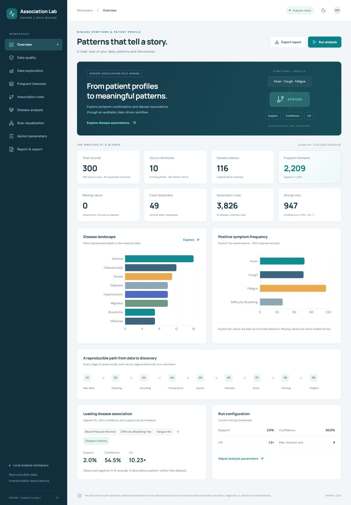

# Association Lab · Technical reference

[← Back to the faculty guide](../README.md)

The analytical reference below documents the original pipeline. For current interface labels and installation instructions, use the main README.

## Default execution results

| Measure | Actual result |
|---|---:|
| Raw rows | 349 |
| Original attributes | 10 |
| Exact duplicate rows | 49 |
| Retained unique profiles | 300 |
| Original missing observations | 0 |
| Distinct disease labels | 116 |
| Mining fields / distinct item labels | 9 / 136 |
| Frequent itemsets | 2,209 |
| Association rules | 3,826 |
| Disease-oriented rules | 12 |

Default parameters: minimum support **0.02**, confidence **0.30**, lift **1.20**, maximum itemset length **4**, maximum rules per family **20,000**. A pattern must occur in at least **6** retained records. No default export cap is reached. All 12 disease-oriented rules at these defaults have **Asthma** as their consequent; other diseases do not satisfy all thresholds. The ten leading disease rules are in `REPORT.md` and the PDF.

These numbers describe the shipped default run. After changing dashboard parameters, consult `results/summary.json` and the regenerated report for the current numbers; this README's baseline table intentionally remains the default comparison.

## Dataset and provenance

The **first dataset in the supplied DMDW6 reference** is used, without substitution:

- Original source: https://www.kaggle.com/datasets/uom190346a/disease-symptoms-and-patient-profile-dataset
- Kaggle owner: `uom190346a`; metadata version **2**, last updated **2024-01-21**.
- Acquired directly from Kaggle on **2026-10-02**.
- Filename: `Disease_symptom_and_patient_profile_dataset.csv`.
- Source metadata lists **MIT** as the dataset license. See the saved source metadata for attribution; clinical collection methodology is not independently verified.
- SHA-256: `79cd5314cfdefec9b86ee0efd63d3df64a619a2e2511c5908abde008edf1bfa8`.
- Manifest: `data/raw/provenance.json`; original API metadata: `references/kaggle_metadata.json`.
- Course PDF and supplied project brief are copied to `references/`.

The source has Disease, Fever, Cough, Fatigue, Difficulty Breathing, Age, Gender, Blood Pressure, Cholesterol Level and Outcome Variable. The brief's Headache and Flu labels were examples; no nonexistent source columns or invented rows were added.

## Architecture

```text
raw CSV -> audit -> cleaning -> transactions -> Boolean matrix
  -> mlxtend Apriori -> itemsets -> association rules -> disease rules
  -> results/*.csv + results/*.json + REPORT.md + PDF + figures
                                     |
                                FastAPI API
                                     |
                      React / Vite / Recharts dashboard
```

Python, pandas, NumPy and mlxtend implement the mining pipeline. FastAPI serves API responses and the built React application. Recharts renders real data. Carefully scoped custom CSS handles the visual system and responsive layouts; Tailwind is unnecessary for this small dashboard and adds no analytical capability. scikit-learn is installed only as mlxtend's dependency; this project does not train a classifier.

## Reproducible preprocessing

1. Read the raw CSV as strings to preserve missing markers and spellings for the audit.
2. Audit dimensions, types, missing markers, duplicates, unique values, numerical distributions, target distribution, whitespace, case variants and suspicious labels.
3. Remove **exact raw-row duplicates** by default, retaining the first occurrence. This is a unique-profile analysis, not proof that the duplicates were the same person. No patient identifiers are available. Use `--keep-duplicates` or the dashboard control for a comparison.
4. Strip whitespace and normalize column names. Normalize known Yes/No, profile and outcome categories; preserve source disease labels while collapsing case variants only.
5. Missing/unknown/invalid values remain Unknown in categorical fields (nullable Age for unknown age), and are omitted from mining. They are never silently set to No. Unexpected symptoms are logged, not guessed.
6. Preserve explicit **Yes and No** symptom items. Keep truncated disease labels and possible aliases separate pending authoritative correction.
7. Retain original ages and derive inclusive bins **0–17, 18–30, 31–45, 46–60, 61–120** (last displayed `61+`). Actual source ages span 19–90, so no under-18 item appears in this dataset. These are descriptive age groups, not clinical risk bands.
8. Exclude `Outcome_Variable` from **all mining** because its semantics are not sufficiently established and using it could mix downstream outcomes into profile patterns. Raw Age is replaced by Age_Group only in mining.
9. Create one transaction per retained row. Keep separately originating records even if the mining transaction becomes identical after outcome exclusion or age binning.

`results/preprocessing_metadata.json` contains the cleaning log and a mapping for every observed raw value: original column/value, transformed field, resulting item and rationale. The cleaned CSV includes the original ten fields with normalized names and the additional Age_Group column. The raw CSV is never modified.

## Apriori and interpretation

`mlxtend.frequent_patterns.apriori` discovers frequent itemsets, and `association_rules` generates rules. All-rule exports include every qualifying direction within search/export limits. Disease rules have **one Disease item as the sole consequent** and **no Disease item in the antecedent**. Independent caps keep general rules from crowding out disease rules.

- **Support:** fraction of retained records containing both sides.
- **Confidence:** fraction of antecedent records also containing the consequent.
- **Lift:** confidence divided by consequent prevalence. Above one means positive association.
- **Leverage:** observed joint support minus the product of marginal supports.
- **Conviction:** `(1 - consequent support) / (1 - confidence)`.

Rules rank by lift, confidence, support and deterministic lexical tie-breakers. High confidence alone can be misleading for common labels. Additional mlxtend metrics are preserved. Infinite conviction is stored as JSON `null` with `conviction_infinite: true`, and displayed as `∞`; undefined additional metrics are `null`, never nonstandard JSON NaN/Infinity.

For example, the default leading disease rule is **Blood_Pressure=Normal + Difficulty_Breathing=Yes + Fatigue=No → Disease=Asthma**. It occurs in 6/300 profiles (support 0.02). Eleven profiles have the antecedent, yielding confidence 6/11 = 0.54545. Asthma occurs in 16/300 profiles, giving lift 10.22727. This is an in-sample association based on six records, not a clinical claim.

The UI's **Strong Rules** KPI means confidence >= 0.70 and lift > 1 among exported general rules. It is not a statistical significance criterion.

## Dashboard

1. **Overview:** record, attribute, disease, quality and mining KPIs; methodology; leading rule; configuration.
2. **Data quality:** before/after counts, missing-value chart, source types/values, cleaning log and suspicious labels.
3. **Data exploration:** searchable categorical distributions, symptom frequency, age, gender, pressure and cholesterol profiles.
4. **Frequent itemsets:** search/support/length filters, table, item frequency and support-length scatter.
5. **Association rules:** all rule directions, search, disease/symptom/metric filters, antecedent length, top N, sortable metrics and filtered CSV.
6. **Disease analysis:** strict disease consequents, per-disease counts, strongest/highest-confidence patterns and symptom participation.
7. **Rule visualization:** support-confidence and lift-confidence scatter plots with tooltips; top lift/confidence charts with ranking tables.
8. **Apriori parameters:** validated inputs, duplicate policy, asynchronous UI loading state and completed-run notification.
9. **Report & export:** current summary and downloadable CSV, JSON, Markdown and PDF.

Display filters only narrow the current mined snapshot. Lowering a display threshold cannot recover a rule excluded during mining; change the Apriori configuration and rerun. Rule exports from the explorer respect its filters and Top N; Report & export offers complete current output files. Chart sampling and category limits are labeled in the UI. Present-symptom participation in the disease view counts **rules**, not patients.

Responsive desktop/tablet/mobile layout, sidebar/mobile menu, light/dark themes, loading/error/empty states and success notifications are included. Screenshots are in `reports/screenshots/`.



## Fresh installation

Prerequisites: **Python 3.11+** and **Node.js 22.12+**. Windows users can double-click `SETUP_PROJECT.cmd`. For explicit commands, run from the project root:

```powershell
python -m venv .venv
.\.venv\Scripts\python.exe -m pip install -r requirements.txt
.\.venv\Scripts\python.exe scripts/download_data.py
.\.venv\Scripts\python.exe scripts/run_pipeline.py
cd frontend
npm.cmd ci
npm.cmd run build
cd ..
.\.venv\Scripts\python.exe -m uvicorn backend.app.main:app --host 127.0.0.1 --port 8000
```

On macOS/Linux, replace `.\.venv\Scripts\python.exe` with `.venv/bin/python` and `npm.cmd` with `npm`. The application itself uses portable paths. The included `.venv` is specific to this Windows machine and should be recreated if the folder is moved to another computer.

The download script preserves an existing raw file. If a fresh download is blocked or requires Kaggle sign-in, obtain the exact CSV from the source and place it under `data/raw/` with the original filename. Never substitute another dataset. The shipped folder already contains the verified CSV.

## Analysis commands

Using the virtual environment's Python (or `python` after activation):

```powershell
python scripts/preprocess.py
python scripts/run_apriori.py
python scripts/run_pipeline.py
python scripts/run_pipeline.py --min-support 0.01 --min-confidence 0.20 --min-lift 1.2 --max-itemset-size 4
python scripts/run_pipeline.py --keep-duplicates
```

`run_pipeline.py` is the authoritative one-command full regeneration, including reports/figures. `run_apriori.py` delegates to that same command to prevent stale preprocessing. `preprocess.py` updates cleaning, audit, metadata and the transaction matrix only; run the full pipeline before consuming analysis/report outputs. If running the CLI while a server is already open, restart the server afterwards to reload its cached snapshot; dashboard-triggered runs update it automatically.

The backend can also be launched with `cd backend` then `uvicorn app.main:app --reload`, after activating the environment. For development, start the backend and in a second terminal run `cd frontend` then `npm.cmd run dev`. Vite proxies `/api` to port 8000.

## API documentation

Full schemas and interactive requests: **http://127.0.0.1:8000/docs**.

| Endpoint | Purpose |
|---|---|
| GET `/api/health` | Service and analysis availability |
| GET `/api/analysis` | Complete dashboard snapshot |
| GET `/api/dataset/summary` | Current counts and provenance hash |
| GET `/api/dataset/columns` | Audit metadata per source column |
| GET `/api/dataset/missing-values` | Missing counts per source column |
| GET `/api/dataset/distribution` | Retained categorical distributions |
| GET `/api/apriori/itemsets` | Support, size, search and Top N filtering |
| GET `/api/apriori/rules` | General-rule filters and sorting |
| GET `/api/apriori/rules/disease` | Strict disease-rule family |
| GET `/api/apriori/top-rules` | Ranked selection of either family |
| GET `/api/apriori/metrics` | Metric definitions and counts |
| POST `/api/apriori/run` | Run pipeline and regenerate reports |
| POST `/api/apriori/filter` | Filter using a validated JSON body |
| GET `/api/export/rules` | Filtered rules CSV, default Top N = 100 |
| GET `/api/export/all-rules` | Complete exported general rules CSV |
| GET `/api/export/disease-rules` | Complete exported disease rules CSV |
| GET `/api/export/itemsets` | Complete itemsets CSV |
| GET `/api/export/cleaned` | Cleaned dataset CSV |
| GET `/api/export/analysis` | Full analysis JSON |
| GET `/api/export/report` | Academic Markdown report |
| GET `/api/export/pdf` | Generated PDF report |

POST run body:

```json
{"min_support":0.02,"min_confidence":0.30,"min_lift":1.20,"max_itemset_size":4,"max_rules":20000,"remove_duplicates":true}
```

Rule filter fields: `min_support`, `min_confidence`, `min_lift`, `max_antecedent_length`, `disease`, `symptom`, `search`, `top_n`, `sort_by`, `descending`, `disease_only`. Symptom names use normalized column names, e.g. `Difficulty_Breathing`; the filter matches explicit Yes and No in the antecedent. Disease matches an exact consequent item. Sort fields include support, confidence, lift, leverage, conviction, antecedent/consequent support and item count.

Invalid input returns 422; a concurrent run returns 409; absent analysis returns 503. Runs compute in a staging folder and publish a complete in-memory snapshot only on success. The local service uses one process; do not launch multiple worker processes against the same output folder. Individual output files are replaced atomically, but the folder as a whole is not a database transaction. Do not export from multiple clients while publishing a run if you require a cross-file snapshot.

## Files

```text
data/raw/             Original CSV and provenance manifest
data/processed/       cleaned_dataset.csv
data/intermediate/    transactions.json, transactions.csv, encoded_transactions.csv
src/                  pipeline.py, reporting.py
backend/app/          FastAPI application
frontend/src/         React dashboard and reusable chart/table components
frontend/dist/        Ready-to-serve production website
scripts/              Download, preprocess, Apriori and full-pipeline commands
tests/                Pipeline, metrics, edge-case and API tests
results/              Itemsets/rules CSVs; audit, metadata, configuration and analysis JSON
reports/              PDF report, figures, validation record, screenshots
notebooks/            Optional interactive analysis walkthrough
references/           Original course PDF, project brief and source metadata
README.md             Setup, usage, design and limitations
REPORT.md             Generated complete academic report
requirements.txt      Exact installed Python dependency versions
frontend/package-lock.json  Locked frontend dependency tree
SETUP_PROJECT.cmd     Fresh Windows environment setup
START_PROJECT.cmd     Open the built local application
```

## Verification

```powershell
.\.venv\Scripts\python.exe -m pytest -q
cd frontend
npm.cmd run build
```

The automated suite covers source identity/loading; audit/cleaning; missing/invalid observations; inclusive age boundaries; meaningful transaction encoding; known hand-counted baskets; independent metric counts for **every** real exported rule; disease-rule restrictions; rule filters and independent caps; empty results; deterministic repeated outputs; all API reads/exports; invalid inputs; concurrent-run rejection; and a real staged rerun. Artificial baskets appear only in isolated unit tests and never enter dataset/result files.

See `reports/VALIDATION.md` for the completed test record and browser/PDF checks. Repeat-run equality ignores the generated timestamp; ordered analytical results and CSVs are deterministic for the same input/configuration/dependencies. The optional notebook is a runnable walkthrough, not a separate source of shipped results.

## Limitations and future improvements

Small data and 116 imbalanced labels limit coverage. Disease label truncation and aliases are unresolved. Identical profiles may represent legitimate different patients, so deduplication is a documented analytical choice. Binning, minimum support and maximum itemset size change discoveries. Closely related rules are redundant, and high lift can rest on only six observations. There is no multiple-testing correction, independent holdout validation or clinical provenance verification. The application has no authentication and is bound to localhost for academic use.

Future work: source verification, authoritative label harmonization, duplicate/binning sensitivity analysis, bootstrap stability, held-out replication, redundant-rule pruning and scale comparisons with FP-growth. The local UI uses a web font when available and falls back to system fonts offline; datasets and analytics need no external service once installed.


## Independent dataset selection

`src/datasets.py` registers the two sources. The default `profiles` source retains every original file location. The `symptoms` source lives entirely under `datasets/symptoms/`, including its immutable raw CSV, provenance, intermediate files, results, PDF, and Markdown report. `src/symptom_pipeline.py` adapts symptom slots into recorded-presence items without creating demographics or negative observations.

`GET /api/datasets` returns the source catalog, readiness, per-source defaults, and whether rerunning is supported. All analysis, distribution, filtering, itemset, metric, rerun, and export endpoints also exist under `/api/datasets/{dataset_id}/`. For example:

- `/api/datasets/profiles/analysis` and `/api/datasets/symptoms/analysis`
- `/api/datasets/symptoms/apriori/rules/disease?disease=Dengue`
- `POST /api/datasets/symptoms/apriori/run`
- `/api/datasets/symptoms/export/pdf`
- `/api/datasets/symptoms/export/rules?disease_only=true&disease=Malaria`

The original `/api/analysis`, `/api/apriori/*`, `/api/dataset/*`, and `/api/export/*` routes remain compatible with the original source by default. Dataset IDs are allowlisted before path construction. Snapshots are cached independently; a rerun stages its selected source's files and replaces only that workspace. A shared writer lock protects report rendering as well as publication. Failed staged runs retain the previous complete cached snapshot.

The UI changes selection only after the catalog and requested snapshot load successfully. It resets source-specific filters and tutorial progress, keeps the current section, and locks controls during loading/rerunning. A failed switch retains the previous source and can be retried. All download links use the selected source namespace, including filtered CSV and tutorial PDF links.

Symptom defaults are support 0.01, confidence 0.30, lift 1.20, itemset size 3, max rules 5,000 per family, and exact-duplicate removal. Omitted API run fields use the selected source's defaults. This larger vocabulary is capped at three-item combinations to bound enumeration. The general-rule export cap also keeps the full dashboard API response below the hosted response-size limit; the complete 1,166-rule disease family is retained. Its saved JSON attachment uses compact serialization so that download also fits the prepared hosted payload budget. The uncapped general-rule count is recorded in the summary and report.

Use `python scripts/run_pipeline.py --dataset symptoms` to regenerate that source. The default CLI command continues to target profiles. Vercel packaging includes `datasets/**`; both prepared sources are readable there, while running an analysis remains local-only. See `tests/test_datasets.py` for schema, semantic, metric, API, export, default-setting, failure, and write-isolation checks.


## Visual exploration and selectable filters

The main views show compact evidence cards, a source-coverage ring, a source-to-cleaned-profile flow, and charts. Methodology, glossary entries, exact chart tables, and long report summaries remain available behind expandable controls. Panel information icons reveal chart captions and counting semantics.

Condition, disease, category, combination, support/confidence/lift, length, and row-limit filters use native select menus. Options come from the selected snapshot, including recorded negative items only where the source supplies them. Removable chips show the active rule filters. The optional `item` rule-filter field matches an exact item in either side of the rule, and filtered CSV uses that same criterion. Legacy free-text API `search` remains supported for compatibility.

Ranked bars display each full association's conditions and outcome directly, rather than ordinal rule names. The chart disease selector scopes both scatter plots and ranked comparisons. Full metric tables remain available through View exact chart metrics. Plot tooltips use the same human-readable labels, without changing the raw identifiers in data exports.

Analysis settings defaults to preset menus. Custom values restores numeric inputs for precise experiments. This changes only the interface; selected-source defaults, backend validation, dataset workspaces, and original saved results are preserved.
